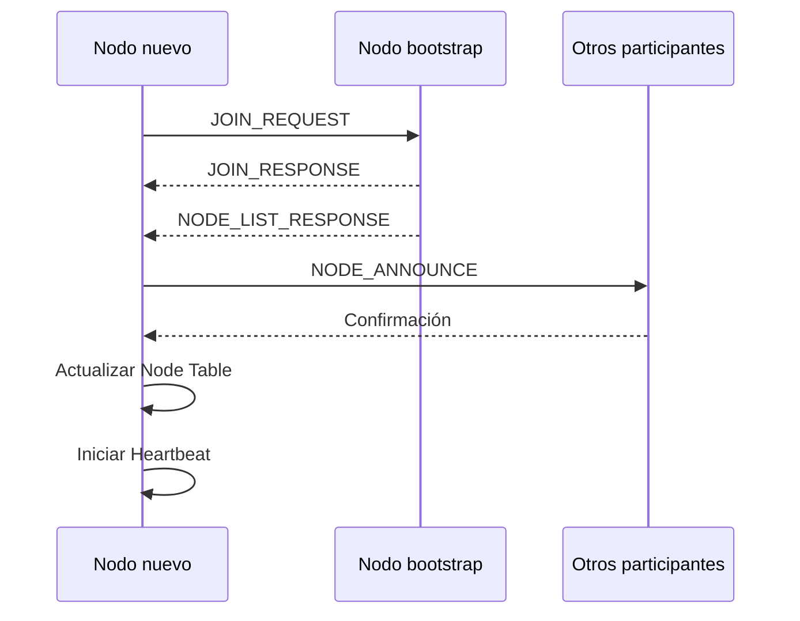
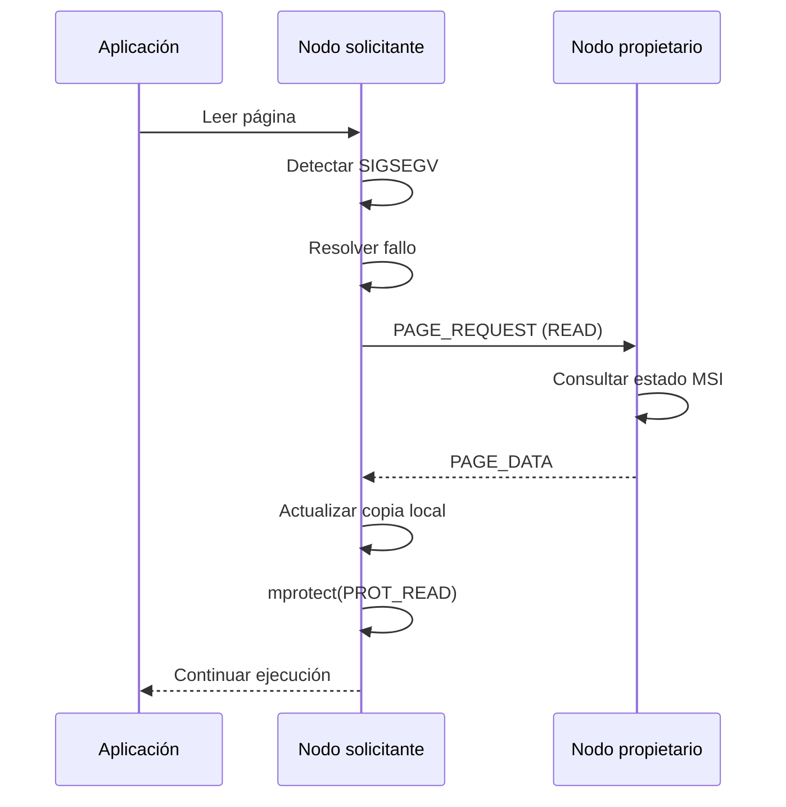
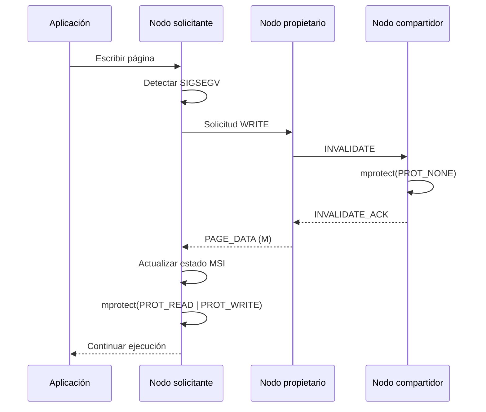

# Instituto Tecnológico de Costa Rica

**Escuela de Ingeniería en Computación, Cartago**

**IC-6600 – Principios de Sistemas Operativos**

**II Semestre 2026**

**Profesor:** M.Sc. Esteban Arias Méndez

**Integrantes:** Daniel Campos, Isaac Gamboa

# Entregable 1 – Documento de Diseño

## Implementación de un Sistema de Memoria Compartida Distribuida (DSM) con Paginación bajo Demanda y Coherencia MSI

**Lenguaje de implementación:** C++
**Sistema operativo:** Linux

---

# 1. Alcance del sistema

La primera versión del sistema estará enfocada en proporcionar las siguientes funcionalidades:

1. Inicio de un nodo DSM mediante un archivo de configuración.
2. Incorporación dinámica de nuevos nodos a un sistema existente.
3. Descubrimiento y registro de nodos participantes.
4. Reserva y administración de memoria local.
5. Administración de un espacio de direcciones DSM lógico.
6. Asignación de páginas a nodos propietarios.
7. Carga de páginas bajo demanda.
8. Sincronización de páginas mediante el protocolo MSI.
9. Comunicación concurrente entre nodos.
10. Consultas de información local y global.
11. Ejecución de aplicaciones de prueba mediante un API de memoria compartida.

La arquitectura inicial no contempla un mecanismo completo de recuperación de datos ante la pérdida permanente de un nodo. La redundancia y tolerancia a fallos se consideran una posible extensión del sistema.

---

# 2. Supuestos y decisiones de diseño

Para establecer una base común de implementación, se definen los siguientes supuestos:

| Característica | Decisión |
|---|---|
| Lenguaje | C++ |
| Plataforma | Linux |
| Arquitectura | Peer-to-peer |
| Cantidad de nodos | Dinámica, sin cantidad fija definida en código |
| Comunicación de datos | TCP |
| Comunicación de heartbeat | UDP |
| Tamaño de página predeterminado | 4096 bytes |
| Tamaño de página | Configurable |
| Reserva de memoria | `mmap` |
| Protección de páginas | `mprotect` |
| Detección de fallos | `sigaction` y `SIGSEGV` |
| Concurrencia | Pthreads |
| Sincronización | Mutexes y semáforos POSIX |
| Coherencia | MSI |
| Configuración | Archivo `.conf` |
| Aplicaciones | Consumirán el API del DSM |

### 2.1 Arquitectura descentralizada

Todos los nodos tendrán las mismas responsabilidades fundamentales. No existirá un nodo maestro ni un servidor central encargado de administrar las páginas.

Cada nodo podrá:

- Incorporarse a un sistema DSM existente.
- Registrar su información y compartir su capacidad de memoria.
- Solicitar páginas almacenadas en otros nodos.
- Proporcionar páginas a otros participantes.
- Administrar las páginas que tenga asignadas.
- Mantener copias locales de páginas compartidas.
- Participar en los mecanismos de coherencia.
- Consultar información global del sistema.

La información de los participantes será replicada entre los nodos mediante mensajes de control.

### 2.2 Incorporación dinámica

La cantidad de nodos no estará definida previamente en el código ni limitada por una lista fija en el archivo de configuración.

Se utilizará un mecanismo de descubrimiento mediante nodos semilla (*bootstrap*).

El primer nodo podrá iniciar un nuevo sistema DSM. Los nodos posteriores podrán conectarse indicando la dirección IP y el puerto de cualquier participante conocido.

Por ejemplo:

```bash
./dsm_node --config dsm.conf --bootstrap 192.168.1.10:5000
```

Cuando un nodo se incorpore:

1. Establecerá una conexión TCP con un nodo existente.
2. Enviará un mensaje `JOIN_REQUEST`.
3. Recibirá la información de los nodos conocidos.
4. Anunciará su incorporación al resto de participantes.
5. Registrará la información de los nodos recibidos.
6. Comenzará a participar en el intercambio de páginas y mensajes de heartbeat.

El nodo utilizado para el descubrimiento inicial no tendrá responsabilidades especiales después de completar el proceso de incorporación.

---

# 3. Arquitectura general del sistema

## 3.1 Descripción general

El sistema estará compuesto por múltiples instancias independientes del programa DSM, cada una ejecutándose en una computadora o terminal diferente.

Cada instancia representará un nodo del sistema y tendrá los módulos necesarios para administrar su memoria, comunicarse con otros participantes y atender las solicitudes de los procesos locales.

La arquitectura estará dividida en cinco componentes principales:

1. Virtual Memory Manager.
2. Network Manager.
3. Pager.
4. Data Structures and Tables.
5. DSM API.

### 3.2 Virtual Memory Manager

Este módulo será responsable de administrar el espacio de memoria virtual reservado por el nodo.

Sus principales responsabilidades serán:

- Reservar el espacio de direcciones mediante `mmap`.
- Establecer los permisos de acceso mediante `mprotect`.
- Administrar las regiones de memoria utilizadas por el DSM.
- Habilitar los permisos correspondientes cuando una página esté disponible localmente.
- Mantener las páginas inválidas protegidas contra accesos no autorizados.

Se utilizará inicialmente una región de memoria virtual reservada con `PROT_NONE`. Conforme las páginas sean solicitadas, el sistema podrá habilitar sus permisos de lectura o escritura.

Es importante distinguir entre la memoria virtual reservada y la memoria física aportada por cada nodo. Reservar un espacio de direcciones mediante `mmap` no significa que toda esa memoria se esté ocupando. La memoria física se utilizará conforme se materialicen las páginas.

### 3.3 Network Manager

El Network Manager administrará toda la comunicación entre los participantes.

Estará compuesto por tres elementos:

**Listener**

Hilo dedicado a escuchar conexiones TCP entrantes. Recibirá solicitudes de otros nodos y distribuirá los mensajes hacia los componentes encargados de procesarlos.

**Workers**

Conjunto de hilos encargados de procesar las solicitudes de red de manera concurrente.

Entre sus responsabilidades se encuentran:

- Procesar solicitudes de páginas.
- Enviar y recibir contenido de páginas.
- Procesar mensajes de invalidación.
- Atender solicitudes de incorporación de nodos.
- Intercambiar información de control.

**Heartbeat**

Componente encargado de verificar periódicamente la disponibilidad de los participantes mediante mensajes UDP.

Cada nodo enviará mensajes periódicos a los demás participantes y actualizará el estado de disponibilidad de su tabla de nodos.

### 3.4 Pager

El Pager será responsable de administrar la paginación bajo demanda y la coherencia de las páginas.

Sus componentes principales serán:

**SIGSEGV Handler**

Detectará accesos a páginas que no tengan permisos suficientes o que no estén disponibles localmente.

**On-demand Paging**

Determinará si una página debe solicitarse a otro nodo, cargarse desde el almacenamiento local o actualizar sus permisos.

**MSI Protocol**

Controlará los estados de las páginas y coordinará las operaciones de lectura, escritura e invalidación.

### 3.5 Data Structures and Tables

Cada nodo mantendrá estructuras de información que permitan conocer el estado local y global del sistema.

Se utilizarán las siguientes tablas:

| Estructura | Responsabilidad |
|---|---|
| Local Page Table | Información de las páginas conocidas y sus estados locales. |
| Node Table | Registro de los nodos participantes. |
| Assignment Table | Relación entre páginas y nodos propietarios. |
| Global Control Table | Información de control sobre la coherencia de las páginas. |
| Statistics | Estadísticas de uso y rendimiento. |

### 3.6 DSM API

El API proporcionará una interfaz de programación para que las aplicaciones puedan reservar, consultar y liberar regiones de memoria DSM.

Las aplicaciones no necesitarán conocer si una página está almacenada localmente o en otro nodo. El sistema se encargará de resolver los accesos mediante los mecanismos de paginación y comunicación.

---

# 4. Diseño de estructuras de datos

Las estructuras de datos deberán permitir identificar páginas, nodos, propietarios, estados de coherencia y asignaciones de memoria.

Para la implementación se utilizarán tipos de tamaño fijo de C++ cuando sea necesario intercambiar información entre nodos.

Algunos tipos de datos a utilizar:

- `uint8_t`: 1 byte.
- `uint16_t`: 2 bytes.
- `uint32_t`: 4 bytes.
- `uint64_t`: 8 bytes.
- `size_t`: tamaño dependiente de la arquitectura.
- `std::string`: cadenas de caracteres.
- `std::vector`: colecciones dinámicas.
- `std::unordered_map`: tablas de búsqueda.

Los tamaños indicados en esta sección corresponden a los campos individuales. El tamaño final de las estructuras en memoria dependerá de la alineación y el padding del compilador.

## 4.1 Identificador de nodo

Cada nodo tendrá un identificador único dentro del sistema DSM.

```cpp
using NodeId = uint64_t;
```

El identificador se generará al iniciar el nodo y se mantendrá durante su participación en el sistema.

La dirección IP y los puertos serán atributos independientes del identificador.

## 4.2 Información de un nodo

```cpp
struct NodeInfo {
    NodeId id;
    std::string ip_address;

    uint16_t tcp_port;
    uint16_t heartbeat_port;

    uint64_t total_memory;
    uint64_t used_memory;

    uint64_t last_heartbeat;

    bool active;
};
```

Descripción:

| Campo | Tipo | Descripción |
|---|---|---|
| id | uint64_t | Identificador único del nodo. |
| ip_address | string | Dirección IP o nombre del equipo. |
| tcp_port | uint16_t | Puerto TCP principal. |
| heartbeat_port | uint16_t | Puerto UDP de heartbeat. |
| total_memory | uint64_t | Memoria aportada al DSM, en bytes. |
| used_memory | uint64_t | Memoria actualmente utilizada, en bytes. |
| last_heartbeat | uint64_t | Último heartbeat recibido. |
| active | bool | Disponibilidad conocida del nodo. |

El campo `last_heartbeat` permitirá determinar si un participante continúa respondiendo.

## 4.3 Estados MSI

Se utilizará un enumerado para representar los estados de coherencia:

```cpp
enum class MSIState : uint8_t {
    MODIFIED = 0,
    SHARED   = 1,
    INVALID  = 2
};
```

Cada estado representa una condición diferente de acceso a la página.

- MODIFIED: el nodo mantiene la copia válida y exclusiva para escritura.
- SHARED: el nodo mantiene una copia válida de solo lectura.
- INVALID: la copia local no es válida o no está disponible.

## 4.4 Información de una página

```cpp
using PageId = uint64_t;

struct PageInfo {
    PageId page_id;

    NodeId owner_id;

    MSIState state;

    uint64_t version;

    bool locally_present;

    std::vector<NodeId> sharers;
};
```

Descripción:

| Campo | Tipo | Descripción |
|---|---|---|
| page_id | uint64_t | Identificador lógico de la página. |
| owner_id | uint64_t | Nodo responsable de la página. |
| state | MSIState | Estado MSI de la copia local. |
| version | uint64_t | Versión del contenido de la página. |
| locally_present | bool | Indica si existe una copia local. |
| sharers | vector | Nodos que mantienen una copia compartida. |

La lista de nodos compartidores será mantenida por el propietario de la página.

La información sobre los compartidores podrá ser consultada mediante mensajes de control.

## 4.5 Tabla local de páginas

Cada nodo mantendrá una tabla de páginas para identificar las páginas que puede administrar o consultar.

```cpp
using LocalPageTable =
    std::unordered_map<PageId, PageInfo>;
```

Esta tabla permitirá realizar búsquedas por identificador de página.

## 4.6 Tabla de nodos

```cpp
using NodeTable =
    std::unordered_map<NodeId, NodeInfo>;
```

Almacena la información de todos los participantes conocidos por el nodo.

Su contenido será actualizado cuando se incorporen nuevos participantes o cuando se detecten cambios en su disponibilidad.

## 4.7 Tabla de asignaciones

```cpp
struct PageAssignment {
    PageId page_id;

    NodeId owner_id;

    uint64_t region_id;

    uint64_t region_offset;
};

using AssignmentTable =
    std::unordered_map<PageId, PageAssignment>;
```

Esta tabla relacionará cada página con el nodo que proporciona su almacenamiento y con la región lógica a la que pertenece.

La asignación de páginas se realizará mediante un mecanismo distribuido que evite asignaciones duplicadas.

## 4.8 Tabla de control global

Se utilizará una tabla de control para almacenar la información necesaria para administrar las páginas y coordinar las operaciones de coherencia.

```cpp
struct GlobalPageControl {
    PageId page_id;

    NodeId owner_id;

    MSIState owner_state;

    uint64_t version;

    std::vector<NodeId> sharers;

    bool write_in_progress;
};
```

Esta información será mantenida por el nodo propietario de cada página y podrá replicarse parcialmente en otros participantes.

No existirá una única tabla global alojada en un servidor central. La información global se obtendrá consultando y combinando los registros de los distintos nodos.

## 4.9 Estadísticas

```cpp
struct NodeStatistics {
    uint64_t pages_owned;
    uint64_t pages_shared;
    uint64_t page_faults;

    uint64_t page_requests;
    uint64_t page_transfers;

    uint64_t bytes_sent;
    uint64_t bytes_received;

    uint64_t invalidations_sent;
    uint64_t invalidations_received;
};
```

Estas estadísticas permitirán evaluar el comportamiento del sistema durante las pruebas.

---

# 5. Gestión de memoria virtual y paginación bajo demanda

## 5.1 Reserva de memoria

Al iniciar, cada nodo reservará una región de memoria virtual mediante `mmap`.

La cantidad de memoria física que aportará al sistema será definida en el archivo de configuración.

Ejemplo:

```cpp
void* memory = mmap(
    nullptr,
    memory_size,
    PROT_NONE,
    MAP_PRIVATE | MAP_ANONYMOUS,
    -1,
    0
);
```

El espacio reservado representará la región virtual utilizada por el DSM.

Cada nodo podrá tener una representación virtual local del espacio DSM, mientras que las páginas físicas estarán distribuidas entre los diferentes participantes.

La asignación de memoria física se realizará bajo demanda, evitando reservar RAM innecesariamente.

## 5.2 Protección de páginas

Inicialmente, las páginas que no estén disponibles localmente tendrán protección `PROT_NONE`.

Cuando una página se encuentre disponible para lectura, se utilizará:

```cpp
mprotect(page_address, page_size, PROT_READ);
```

Cuando el protocolo MSI permita escritura exclusiva:

```cpp
mprotect(
    page_address,
    page_size,
    PROT_READ | PROT_WRITE
);
```

Cuando una página sea invalidada:

```cpp
mprotect(page_address, page_size, PROT_NONE);
```

La modificación de permisos se realizará respetando los límites y la alineación del tamaño de página del sistema operativo.

## 5.3 Detección de fallos SIGSEGV

Se instalará un manejador de señales utilizando `sigaction` y la bandera `SA_SIGINFO`.

Esto permitirá obtener información sobre la dirección virtual que ocasionó el fallo.

Ejemplo conceptual:

```cpp
struct sigaction sa {};

sa.sa_sigaction = segv_handler;
sa.sa_flags = SA_SIGINFO;

sigemptyset(&sa.sa_mask);

sigaction(SIGSEGV, &sa, nullptr);
```

El manejador recibirá:

```cpp
void segv_handler(
    int signal,
    siginfo_t* info,
    void* context
);
```

A partir de `info->si_addr` se determinará la dirección que produjo el fallo.

El identificador de página se calculará utilizando el desplazamiento respecto a la dirección inicial de la región DSM:

```cpp
page_id = (fault_address - region_base) / page_size;
```

## 5.4 Procesamiento de fallos

El manejador de señales no ejecutará directamente operaciones de red, asignaciones dinámicas de memoria ni bloqueos de mutexes.

En su lugar, se utilizará un mecanismo de comunicación seguro entre el manejador y un hilo encargado de resolver los fallos.

El flujo propuesto será:

1. Un hilo de usuario intenta acceder a una página.
2. El kernel genera `SIGSEGV`.
3. El manejador identifica la dirección que produjo el fallo.
4. El manejador registra el evento mediante una operación segura para señales, como `write` sobre un descriptor de una tubería.
5. El hilo encargado de resolver fallos recibe el evento.
6. Se consulta el estado de la página.
7. Si es necesario, se solicita la página al propietario mediante TCP.
8. Se procesa la respuesta y se actualiza el contenido local.
9. Se establecen los permisos adecuados mediante `mprotect`.
10. Se notifica al hilo afectado para que continúe su ejecución.

Para implementar la espera del hilo afectado se utilizará un mecanismo de notificación mediante señales y una espera compatible con las restricciones de seguridad de los manejadores. La implementación deberá evitar que el hilo reintente el acceso antes de que la página esté lista.

## 5.5 Tipos de fallos

Se contemplan dos situaciones principales:

**Fallo de lectura**

Ocurre cuando un proceso intenta leer una página que no está disponible localmente.

El sistema consultará el propietario, solicitará una copia y, cuando sea posible, establecerá el estado SHARED.

**Fallo de escritura**

Ocurre cuando un proceso intenta escribir sobre una página que está protegida como solo lectura o que no está disponible localmente.

El sistema deberá solicitar acceso exclusivo y ejecutar el protocolo de invalidación sobre las demás copias existentes.

---

# 6. Diseño del protocolo de coherencia MSI

## 6.1 Descripción general

El protocolo MSI permitirá mantener la coherencia entre las copias de una misma página almacenadas en diferentes nodos.

Cada copia local tendrá uno de los siguientes estados:

| Estado | Significado | Permisos |
|---|---|---|
| Modified (M) | Copia exclusiva y modificada. | Lectura y escritura |
| Shared (S) | Copia sincronizada compartida. | Solo lectura |
| Invalid (I) | Copia no disponible o desactualizada. | Sin permisos |

El nodo propietario será responsable de coordinar las operaciones de coherencia correspondientes a su página.

## 6.2 Transiciones de estado

Las principales transiciones serán:

| Estado inicial | Evento | Acción | Estado final |
|---|---|---|---|
| I | Lectura | Solicitar página al propietario. | S |
| I | Escritura | Solicitar propiedad exclusiva. | M |
| S | Lectura | Utilizar copia local. | S |
| S | Escritura | Solicitar invalidación de otras copias. | M |
| M | Lectura remota | Compartir contenido y degradar al estado compartido. | S |
| M | Escritura local | Continuar utilizando la copia exclusiva. | M |
| M | Invalidación o transferencia de propiedad | Transferir contenido y actualizar estados. | I |

## 6.3 Lectura de una página

Cuando un nodo necesite leer una página:

1. Comprueba si tiene una copia válida.
2. Si se encuentra en estado S o M, permite la lectura.
3. Si se encuentra en estado I, envía `PAGE_REQUEST` al propietario.
4. El propietario consulta el estado MSI.
5. Si el propietario tiene la página en M, proporciona el contenido actualizado y realiza la transición correspondiente a S.
6. El nodo solicitante recibe `PAGE_DATA`.
7. Se actualiza su copia local y se establece el permiso de lectura.

El propietario registrará al nuevo nodo como compartidor.

## 6.4 Escritura de una página

Cuando un nodo necesite escribir sobre una página:

1. Comprueba el estado local.
2. Si está en M, puede escribir directamente.
3. Si está en S o I, solicita acceso exclusivo.
4. El propietario identifica los nodos que mantienen copias compartidas.
5. Envía mensajes `INVALIDATE` a los participantes correspondientes.
6. Cada nodo invalida su copia local mediante `mprotect(PROT_NONE)`.
7. Los participantes responden con `INVALIDATE_ACK`.
8. El propietario confirma que se puede conceder el acceso exclusivo.
9. El nodo solicitante recibe la página y los permisos correspondientes.
10. El nodo pasa al estado M.

La escritura solamente podrá comenzar cuando se haya completado la invalidación de las copias anteriores.


## 6.5 Control de versiones

Cada página mantendrá un número de versión (`uint64_t`) que aumentará cuando se complete una operación de escritura.

Este valor permitirá detectar respuestas desactualizadas y ayudar a validar que las transferencias correspondan a la versión esperada.

El propietario será responsable de mantener la versión vigente.

---

# 7. Capa de red y protocolo de mensajería

## 7.1 Comunicación TCP

TCP será utilizado para los mensajes de control y transferencia de páginas.

Cada nodo tendrá un puerto TCP de escucha.

El Network Listener Thread recibirá las conexiones entrantes y distribuirá las solicitudes entre los hilos de procesamiento.

Se utilizará un protocolo de mensajes estructurado, con una cabecera de tamaño fijo y un contenido de longitud variable.

## 7.2 Formato general de mensajes

Se propone la siguiente estructura lógica:

```cpp
struct MessageHeader {
    uint32_t magic;
    uint16_t version;
    uint16_t type;

    uint32_t payload_size;

    uint64_t message_id;

    uint64_t sender_id;
    uint64_t receiver_id;

    uint32_t flags;
    uint32_t reserved;
};
```

Tamaño de la cabecera:

| Campo | Tamaño |
|---|---:|
| magic | 4 bytes |
| version | 2 bytes |
| type | 2 bytes |
| payload_size | 4 bytes |
| message_id | 8 bytes |
| sender_id | 8 bytes |
| receiver_id | 8 bytes |
| flags | 4 bytes |
| reserved | 4 bytes |
| **Total** | **44 bytes** |

La cabecera tendrá un tamaño lógico de 44 bytes. Se utilizará serialización explícita para evitar diferencias de alineación, padding y representación entre compiladores y arquitecturas.

Todos los campos numéricos del protocolo utilizarán orden de bytes de red (*network byte order*).

El campo `magic` permitirá identificar mensajes pertenecientes al protocolo DSM.

El campo `version` permitirá identificar la versión del protocolo.

El campo `type` indicará el tipo de mensaje.

El campo `payload_size` indicará la longitud del contenido adicional.

El campo `message_id` permitirá identificar cada solicitud y relacionar respuestas con sus solicitudes originales.

## 7.3 Tipos de mensajes

Se definen los siguientes 20 tipos (`MessageType` en `include/protocol.hpp`).
Toda la comunicación de control, páginas y consultas comparte el único socket TCP
en `tcp_port`; no existe un puerto de control separado. El heartbeat usa UDP.

| Código | Mensaje | Transporte | Descripción |
|---:|---|---|---|
| 1 | JOIN_REQUEST | TCP | Solicita incorporación al sistema. |
| 2 | JOIN_RESPONSE | TCP | Responde a una solicitud de incorporación. |
| 3 | NODE_ANNOUNCE | TCP | Anuncia un nuevo nodo a los participantes. |
| 4 | NODE_LIST_REQUEST | TCP | Solicita la lista de participantes conocidos. |
| 5 | NODE_LIST_RESPONSE | TCP | Devuelve información de nodos conocidos. |
| 6 | PAGE_REQUEST | TCP | Solicita una página (lectura o escritura). |
| 7 | PAGE_DATA | TCP | Transfiere el contenido y la versión de una página. |
| 8 | INVALIDATE | TCP | Solicita invalidar una copia remota. |
| 9 | INVALIDATE_ACK | TCP | Confirma una invalidación. |
| 10 | PAGE_RELEASE | TCP | Devuelve una copia modificada al dueño. |
| 11 | STATUS_REQUEST | TCP | Solicita secciones del estado del nodo. |
| 12 | STATUS_RESPONSE | TCP | Devuelve texto con las secciones solicitadas. |
| 13 | ERROR_RESPONSE | TCP | Informa sobre un error de protocolo o de página. |
| 14 | HEARTBEAT | UDP | Informa que un nodo continúa activo. |
| 15 | NODE_LEAVE | TCP | Notifica la salida ordenada de un nodo. |
| 16 | NODE_LEAVE_ACK | TCP | Confirma la salida del nodo. |
| 17 | REGION_INFO_REQUEST | TCP | Consulta una región por identificador y dueño. |
| 18 | REGION_INFO_RESPONSE | TCP | Devuelve la descripción de la región. |
| 19 | REGION_LIST_REQUEST | TCP | Solicita las regiones propias de un nodo. |
| 20 | REGION_LIST_RESPONSE | TCP | Devuelve las regiones propias del nodo. |

El código `13` (`ERROR_RESPONSE`) transporta los códigos de la sección 7.9.
Los mensajes 15 a 20 se añadieron para la salida ordenada y el descubrimiento
de regiones. La versión actual del protocolo es 6.

## 7.4 Mensaje JOIN_REQUEST

Se utilizará cuando un nodo nuevo desee incorporarse al sistema.

Contenido propuesto:

```cpp
struct JoinRequest {
    NodeId node_id;

    uint64_t memory_size;

    uint16_t tcp_port;
    uint16_t heartbeat_port;

    uint16_t protocol_version;
};
```

El nodo existente validará la solicitud y responderá con `JOIN_RESPONSE`.

## 7.5 Mensaje PAGE_REQUEST

Se utilizará para solicitar el contenido o los permisos de una página.

```cpp
struct PageRequest {
    PageId page_id;

    uint64_t region_id;

    uint8_t access_type;
    uint8_t current_state;

    uint64_t known_version;
};
```

El campo `access_type` permitirá distinguir entre solicitudes de lectura y escritura.

Valores:

- 0: READ.
- 1: WRITE.

## 7.6 Mensaje PAGE_DATA

Permitirá transferir el contenido de una página y la información necesaria para actualizar su estado local.

```cpp
struct PageData {
    PageId page_id;

    uint64_t version;

    uint8_t state;

    uint32_t data_size;

    // Contenido de la página enviado como payload.
};
```

El contenido de la página se transmitirá como un bloque adicional al mensaje.

Para una página de 4096 bytes, el payload de datos tendrá exactamente 4096 bytes.

## 7.7 Mensaje INVALIDATE

Se utilizará para notificar a un nodo que su copia local de una página debe invalidarse.

```cpp
struct InvalidateMessage {
    PageId page_id;

    uint64_t new_version;

    NodeId new_owner;
};
```

El receptor deberá:

1. Identificar la página.
2. Invalidar su copia local.
3. Aplicar `mprotect(PROT_NONE)`.
4. Actualizar su tabla local.
5. Enviar `INVALIDATE_ACK`.

## 7.8 Mensaje HEARTBEAT

Se utilizará para informar periódicamente que un nodo continúa disponible.

Se propone un paquete UDP compacto:

```cpp
struct HeartbeatMessage {
    uint64_t node_id;

    uint64_t timestamp;

    uint32_t sequence_number;
};
```

Tamaño lógico: 20 bytes.

El campo `sequence_number` permitirá identificar mensajes repetidos o desordenados.

## 7.9 Manejo de errores

El protocolo deberá contemplar los siguientes errores:

| Código | Error | Descripción |
|---:|---|---|
| 1 | INVALID_MESSAGE | Mensaje inválido. |
| 2 | UNKNOWN_NODE | Nodo desconocido. |
| 3 | PAGE_NOT_FOUND | Página inexistente. |
| 4 | ACCESS_DENIED | Operación no permitida. |
| 5 | INVALID_STATE | Estado MSI inesperado. |
| 6 | OUT_OF_MEMORY | Memoria disponible insuficiente. |
| 7 | NODE_UNAVAILABLE | Nodo no disponible. |
| 8 | VERSION_MISMATCH | Versión de página incorrecta. |
| 9 | TIMEOUT | Tiempo de espera agotado. |
| 10 | PROTOCOL_MISMATCH | Versiones de protocolo incompatibles. |

La respuesta a cada mensaje usa los siguientes códigos. `INVALID_MESSAGE` se
aplica a cualquier mensaje mal formado, y `UNKNOWN_NODE` a un `receiver_id`
ajeno cuando la cabecera lo especifica.

| Mensaje | Errores posibles |
|---|---|
| JOIN_REQUEST / JOIN_RESPONSE | INVALID_MESSAGE, PROTOCOL_MISMATCH, INVALID_STATE |
| NODE_ANNOUNCE | INVALID_MESSAGE, PROTOCOL_MISMATCH, INVALID_STATE |
| NODE_LEAVE / NODE_LEAVE_ACK | INVALID_MESSAGE, UNKNOWN_NODE |
| NODE_LIST_REQUEST / NODE_LIST_RESPONSE | INVALID_MESSAGE, OUT_OF_MEMORY |
| PAGE_REQUEST / PAGE_DATA | INVALID_MESSAGE, PAGE_NOT_FOUND, INVALID_STATE |
| INVALIDATE / INVALIDATE_ACK | INVALID_MESSAGE, INVALID_STATE |
| PAGE_RELEASE | INVALID_MESSAGE, INVALID_STATE |
| STATUS_REQUEST / STATUS_RESPONSE | INVALID_MESSAGE, INVALID_STATE |
| REGION_INFO_REQUEST / REGION_INFO_RESPONSE | INVALID_MESSAGE, PAGE_NOT_FOUND, INVALID_STATE |
| REGION_LIST_REQUEST / REGION_LIST_RESPONSE | INVALID_MESSAGE, PAGE_NOT_FOUND, INVALID_STATE |
| HEARTBEAT | Sin respuesta: los datagramas inválidos se descartan. |

Los errores de tiempo de espera (`TIMEOUT`) y de nodo no disponible
(`NODE_UNAVAILABLE`) los determina el solicitante, no el receptor.

---

# 8. Modelo de concurrencia y sincronización

## 8.1 Modelo de hilos

Cada nodo ejecutará múltiples hilos con responsabilidades independientes.

Se propone la siguiente distribución:

| Hilo | Responsabilidad |
|---|---|
| Main Thread | Inicialización y administración del nodo. |
| TCP Listener | Aceptar conexiones entrantes. |
| Network Workers | Procesar mensajes de otros nodos. |
| Heartbeat Thread | Enviar y recibir mensajes de disponibilidad. |
| Fault Handler Worker | Resolver los fallos de página detectados. |
| Statistics Thread | Actualizar y recopilar estadísticas. |
| Application Threads | Ejecutar las aplicaciones que utilizan el DSM. |

La cantidad de hilos de procesamiento de red podrá configurarse.

## 8.2 Sincronización

Debido a que varios hilos podrán consultar y modificar simultáneamente las tablas de control, se utilizarán mecanismos de sincronización.

Se implementarán:

- Mutexes POSIX mediante `pthread_mutex_t`.
- Semáforos POSIX mediante `sem_t`.
- Variables de condición cuando sean necesarias.
- Operaciones atómicas para contadores y estados que lo permitan.

Se propone proteger las estructuras de la siguiente manera:

| Estructura | Mecanismo |
|---|---|
| Local Page Table | Mutex de tabla o mutex por página. |
| Node Table | Mutex de nodos. |
| Assignment Table | Mutex de asignaciones. |
| Global Control Table | Mutex por página. |
| Statistics | Operaciones atómicas o mutex. |
| Cola de fallos | Pipe y semáforos POSIX. |

Se evitará utilizar un único mutex global para todas las operaciones, debido a que podría limitar la concurrencia y generar tiempos de espera innecesarios.

## 8.3 Prevención de interbloqueos

Se establecerán las siguientes reglas:

1. Los mutexes deberán adquirirse siguiendo un orden consistente.
2. No se mantendrán bloqueos de tablas mientras se espera una respuesta de red.
3. Las solicitudes de red tendrán tiempos máximos de espera.
4. Las operaciones de invalidación utilizarán identificadores de solicitud.
5. Los hilos no deberán esperar indefinidamente por respuestas de otros nodos.
6. Los mensajes duplicados deberán poder identificarse mediante `message_id`.
7. Las operaciones sobre una misma página deberán serializarse cuando sea necesario.

Se prestará especial atención a las operaciones MSI que involucren varios nodos, ya que podrían producir esperas circulares si no se establecen reglas claras de adquisición de bloqueos.

## 8.4 Comunicación entre SIGSEGV y los hilos de procesamiento

El manejador de señales tendrá restricciones especiales.

No realizará operaciones de red, asignaciones dinámicas, operaciones de entrada/salida complejas ni bloqueos tradicionales.

Se utilizará una tubería de comunicación entre el manejador y el Fault Handler Worker.

La escritura de eventos mediante `write` permite utilizar una operación compatible con manejadores de señales.

El procesamiento de las solicitudes, incluyendo sockets, semáforos y mutexes, se realizará desde el hilo de trabajo.

---

# 9. Diseño inicial del API DSM

## 9.1 Objetivo

El API permitirá que las aplicaciones utilicen el espacio de memoria compartida sin necesitar conocer los mecanismos internos de distribución, comunicación y coherencia.

Se propone desarrollar una interfaz en C++ basada en una clase principal `DSM` y una abstracción `DSMRegion`.

Las aplicaciones utilizarán esta interfaz para inicializar el sistema, crear regiones de memoria, acceder a sus datos y liberar los recursos.

## 9.2 Tipos principales

```cpp
using DSMRegionId = uint64_t;

enum class DSMAccess {
    READ,
    WRITE,
    READ_WRITE
};

enum class DSMError {
    SUCCESS,
    INITIALIZATION_ERROR,
    OUT_OF_MEMORY,
    INVALID_REGION,
    INVALID_ACCESS,
    NETWORK_ERROR,
    NODE_UNAVAILABLE,
    PAGE_FAULT_ERROR,
    INTERNAL_ERROR
};
```

## 9.3 Clase DSM

Interfaz inicial propuesta:

```cpp
class DSM {
public:

    static DSMError initialize(
        const std::string& config_path
    );

    static DSMRegion create_region(
        size_t size,
        DSMAccess access
    );

    static DSMError release_region(
        DSMRegionId region_id
    );

    static DSMError shutdown();

    static DSMStatistics get_statistics();

    static DSMNodeInfo get_local_node();

    static std::vector<DSMNodeInfo> get_nodes();
};
```

## 9.4 Clase DSMRegion

Representará una región de memoria compartida.

```cpp
class DSMRegion {
public:

    DSMRegionId get_id() const;

    size_t get_size() const;

    bool read(size_t offset, void* buffer, size_t size) const;

    bool write(size_t offset, const void* buffer, size_t size);

    bool valid() const;
};
```

`read()` y `write()` copian bytes dentro de los límites de la región; devuelven `false` si el rango no cabe, si la región fue liberada o si el worker no pudo resolver una página. Internamente acceden a la dirección virtual local mediante los mecanismos de protección de memoria y paginación bajo demanda.

## 9.5 Descripción de funciones

| Función | Descripción | Entrada | Salida |
|---|---|---|---|
| initialize | Inicializa el nodo DSM y sus componentes. | Ruta del archivo `.conf`. | Estado de inicialización. |
| create_region | Solicita una nueva región de memoria compartida. | Tamaño y permisos. | Objeto DSMRegion. |
| release_region | Libera una región previamente creada. | Identificador de región. | Código de resultado. |
| shutdown | Finaliza ordenadamente el nodo DSM. | Ninguna. | Código de resultado. |
| get_statistics | Obtiene estadísticas locales. | Ninguna. | Estructura de estadísticas. |
| get_local_node | Obtiene información del nodo local. | Ninguna. | Información del nodo. |
| get_nodes | Obtiene la lista de nodos conocidos. | Ninguna. | Vector de nodos. |
| get_id | Obtiene el identificador de una región. | Ninguna. | Identificador. |
| get_size | Obtiene el tamaño de una región. | Ninguna. | Tamaño en bytes. |
| read | Copia bytes desde un desplazamiento de la región. | Desplazamiento, buffer y tamaño. | Éxito o error DSM. |
| write | Copia bytes hacia un desplazamiento de la región. | Desplazamiento, buffer y tamaño. | Éxito o error DSM. |
| valid | Comprueba si la región es válida. | Ninguna. | Valor booleano. |

## 9.6 Ejemplo de utilización

El siguiente ejemplo muestra el uso esperado del API desde una aplicación independiente:

```cpp
#include "dsm.hpp"
#include <iostream>

int main() {

    DSMError result =
        DSM::initialize("dsm.conf");

    if (result != DSMError::SUCCESS) {
        std::cerr << "Error initializing DSM\n";
        return 1;
    }

    auto region = DSM::create_region(4096 * 100);

    if (!region.valid()) {
        std::cerr << "Error creating region\n";
        DSM::shutdown();
        return 1;
    }

    for (int i = 0; i < 1000; i++) {
        const int value = i;
        if (!region.write(i * sizeof(int), &value, sizeof(value))) {
            std::cerr << "Error writing DSM\n";
            return 1;
        }
    }

    int first = 0;
    if (!region.read(0, &first, sizeof(first))) {
        std::cerr << "Error reading DSM\n";
        return 1;
    }
    std::cout << "First value: " << first << '\n';

    DSM::release_region(region.get_id());

    DSM::shutdown();

    return 0;
}
```

Este ejemplo representa la interfaz deseada. La implementación interna será responsable de resolver los fallos de página y sincronizar los accesos entre nodos.

### 9.7 Consideraciones del API

El acceso mediante copias acotadas evita exponer punteros que queden colgando tras una liberación.

Se aplican las siguientes restricciones:

- Las regiones tendrán un tamaño definido al momento de crearse.
- `read()` y `write()` validan que el rango completo quepa en la región.
- Un `DSMRegion` copiado comparte el handle; `release_region(id)` y `shutdown()` invalidan todas sus copias.
- No se transmiten direcciones entre nodos. Se transmiten identificadores de región, desplazamientos y datos.
- Las operaciones de sincronización entre hilos de aplicación deberán utilizar los mecanismos definidos por el DSM.

El API podrá ampliarse durante los siguientes prototipos según las necesidades de las aplicaciones de validación.

### 9.8 API implementada en el hito 3.1

La cabecera pública es `include/dsm.hpp` y la biblioteca es `build/libdsm.a`. Las aplicaciones no necesitan incluir las cabeceras de red, páginas o señales. `apps/dsm_app.cpp` muestra cómo crear una región o adjuntar una región remota mediante `DSM::attach_region(region_id, owner_id)`.

#### API público completo

| Función | Resultado | Errores (`DSMError`) |
|---|---|---|
| `DSM::initialize(config)` | Prepara el runtime del proceso. | SUCCESS, ALREADY_INITIALIZED, BUSY, INITIALIZATION_ERROR, OUT_OF_MEMORY, NETWORK_ERROR |
| `DSM::create_region(size, access)` | Región propia; actualiza `last_error()`. | SUCCESS, NOT_INITIALIZED, INVALID_ACCESS, INVALID_REGION, OUT_OF_MEMORY |
| `DSM::attach_region(id, owner)` | Copia local de una región remota. | SUCCESS, NOT_INITIALIZED, INVALID_REGION, NODE_UNAVAILABLE, NETWORK_ERROR |
| `DSM::release_region(id)` | Libera la región o desadjunta la copia. | SUCCESS, NOT_INITIALIZED, INVALID_REGION, BUSY, NETWORK_ERROR |
| `DSM::shutdown()` | Cierra el runtime en el hilo de `initialize`. | SUCCESS, INVALID_THREAD, BUSY, NETWORK_ERROR |
| `DSM::get_statistics()` | Contadores locales del proceso. | SUCCESS |
| `DSM::get_local_node()` | Identidad y puertos del nodo local. | SUCCESS |
| `DSM::get_nodes()` | Snapshot de participantes conocidos. | SUCCESS |
| `DSM::get_regions()` | Regiones propias y copias adjuntadas. | SUCCESS |
| `DSM::get_remote_regions(owner)` | Regiones propias de `owner`. | SUCCESS, INVALID_REGION, NODE_UNAVAILABLE, NETWORK_ERROR |
| `DSM::last_error()` / `last_error_message()` | Estado del último error del hilo. | Cualquiera de los anteriores |
| `DSMRegion::get_id()` / `get_size()` | Identificador y tamaño redondeado. | Sin error propio |
| `DSMRegion::read(offset, buffer, size)` | Copia bytes de la región. | SUCCESS, INVALID_REGION, PAGE_FAULT_ERROR |
| `DSMRegion::write(offset, buffer, size)` | Copia bytes a la región. | SUCCESS, INVALID_REGION, PAGE_FAULT_ERROR |
| `DSMRegion::valid()` | Comprueba que el handle local siga vivo. | Sin error propio |
| `DSMThread()` / `valid()` | Registra al hilo adicional mientras accede a DSM. | `valid()` es false si el hilo no se registró |

```sh
./build_manual.sh
./test_manual.sh
./build/dsm_app config/dsm.conf
```

La aplicación crea una región, escribe 42 y muestra los identificadores del nodo y de la región. Permanece activa hasta recibir Enter. En otra terminal se puede ejecutar:

```sh
./build/dsm_app /ruta/al/segundo.conf REGION_ID OWNER_ID
```

El segundo archivo debe configurar otro puerto TCP, el mismo `page_size` y `bootstrap_nodes` apuntando a la dirección y puerto del primer nodo. La segunda aplicación lee 42, escribe 43, devuelve los datos al dueño y termina. Al pulsar Enter en la primera se imprime 43 y se liberan sus recursos.

También se puede compilar una aplicación fuera de los targets del proyecto:

```sh
g++ -std=c++17 -Iinclude apps/dsm_app.cpp build/libdsm.a -pthread -o /tmp/dsm_app
```

Contrato de esta versión:

- Existe un runtime DSM por proceso. `initialize` y `shutdown` deben ejecutarse en el mismo hilo. El hilo inicial queda preparado automáticamente para los fallos de página.
- Cada hilo adicional debe mantener una guardia `DSMThread` durante sus accesos a memoria DSM y comprobar `valid()`. La guardia se crea y destruye en ese hilo. `shutdown` devuelve `BUSY` si todavía existen guardias o llamadas pendientes; la aplicación debe reunir sus hilos antes de apagar DSM.
- Solo se admite `DSMAccess::READ_WRITE`. `READ` y `WRITE` devuelven `INVALID_ACCESS` porque todavía no se imponen permisos por región.
- Los tamaños se redondean al tamaño de página configurado. `read()` y `write()` copian bytes y validan los límites; la aplicación sincroniza sus accesos concurrentes.
- Copiar un `DSMRegion` copia su handle; destruirlo no libera la región. `release_region(id)` y `shutdown()` invalidan todas sus copias locales; las copias invalidadas devuelven `INVALID_REGION`.
- Antes de liberar una región se deben detener sus accesos y las otras operaciones sobre ella. Desadjuntar una región remota devuelve cualquier contenido modificado al dueño mediante `PAGE_RELEASE`. Liberarla en el dueño invalida las copias remotas y destruye la región; sus usuarios deben coordinar ese cierre. `valid()` comprueba la vida del handle local, no la disponibilidad del dueño remoto.
- Los espacios liberados se limpian y pueden reutilizarse; los rangos libres contiguos se fusionan. Si una liberación explícita falla por timeout, conserva el handle para reintentar. `shutdown` informa `NETWORK_ERROR` si no puede devolver los datos y mantiene el runtime vivo para reintentarlo.
- `last_error()` y `last_error_message()` pertenecen al hilo que realizó la última llamada. Las consultas devuelven snapshots de nodos y estadísticas.
- Se mantienen las restricciones actuales: Linux x86-64, uso reservado de `SIGUSR1`, sin persistencia ni recuperación de datos ante la caída del dueño. El protocolo usa la versión 6; todos los nodos deben recompilarse con la misma revisión.

---

### 9.9 Consultas locales y globales del hito 3.2

La consola admite `nodes --active`, `memory --global`, `pages --global` y `stats --global`. Los comandos sin opciones conservan sus consultas locales. Desde el hito 3.3, `nodes --active` filtra la tabla local de disponibilidad mantenida por el heartbeat y no realiza consultas TCP; `nodes` muestra además el estado `ACTIVE`/`SUSPECT`/`UNAVAILABLE` y la antigüedad del último heartbeat.

El cliente externo descubre participantes mediante `NODE_LIST_REQUEST` y consulta a cada uno con `STATUS_REQUEST`:

```sh
./build/dsm_status 127.0.0.1 27400 --memory
./build/dsm_status 127.0.0.1 27400 --global
./build/dsm_status 127.0.0.1 27400 --global --memory
./build/dsm_status 127.0.0.1 27400 --global --pages
./build/dsm_status 127.0.0.1 27400 --global --stats
./build/dsm_status 127.0.0.1 27400 --global --nodes
bash scripts/demo_local.sh
```

`--global` sin otra selección muestra memoria, páginas y estadísticas. `--global --nodes` comprueba disponibilidad sin pedir esas secciones. `--all` incluye también memoria e historial. Las tablas alinean los encabezados con sus valores y convierten bytes a KB o MB usando divisores de 1024; las líneas `total_...` conservan los enteros exactos en bytes o contadores.

`--html` genera un archivo en el directorio actual con el mismo texto de la
consulta, y `--open` lo abre con `xdg-open` (implica `--html`). El nombre es
`dsm-global-<IPv4>-<puerto>.html` para `--global` y
`dsm-node-<IPv4>-<puerto>.html` en caso contrario, de modo que varios nodos en
una misma máquina no se sobrescriban. El texto se escapa antes de incrustarlo
en el HTML porque las líneas `node_name` y `error` provienen de participantes
remotos. Las líneas de página incluyen `pid=` (proceso que creó la región) y
`order=` (orden de asignación local); ambos son cero en las copias remotas
porque esos datos no viajan en el protocolo.

`STATUS_FLAG_MEMORY` utiliza el bit `0x08` y solicita `memory_configured`, `memory_reserved`, `memory_pages_total`, `memory_pages_used` y `memory_pages_free`. La memoria configurada conserva el tamaño solicitado; la reservada incluye el redondeo a páginas. Las páginas usadas son las asignadas a regiones locales, propias o adjuntas, aunque estén en estado I. Las libres pueden reutilizarse para crear o adjuntar regiones. Estos valores describen la reserva virtual DSM, no el consumo físico de RAM.

La agregación suma únicamente respuestas válidas y completas. Cada nodo conserva su fila y, si falla, aparece como `NO CONSULTADO`, con su nombre, identificador, dirección y causa. `global_partial=si` indica que los totales cubren solo los nodos consultados. Una respuesta con campos faltantes, repetidos o inválidos tampoco se suma. La consulta trabaja con una lista de participantes y snapshots tomados sucesivamente; no representa una instantánea atómica de todo el sistema.

Los contadores globales son sumas locales. `pages_total` y `pages_shared` pueden contar varias copias de una misma página lógica. Por ejemplo, una página en S en A, B y C aporta 3 al total `pages_shared`. Los bytes enviados y recibidos se suman por separado y describen tráfico de páginas, no toda la comunicación administrativa.

`NetworkManager::query_status(node, flags, error)` devuelve texto o una cadena vacía con la causa del fallo. Comparte el plazo configurado de `request_timeout_ms` entre conexión, envío y recepción, sin mantener locks durante la espera. El cliente externo usa cinco segundos por participante y realiza las consultas secuencialmente; varios participantes inaccesibles pueden acumular esos tiempos.

El cliente termina con código 0 cuando obtiene una consulta completa, 2 cuando imprime resultados parciales y 1 si no logra descubrir participantes u ocurre un error de argumentos. Debe consultarse una dirección inicial disponible.

Con el heartbeat del hito 3.3, un proceso terminado con `SIGKILL` se marca `UNAVAILABLE` cuando vence `heartbeat_timeout_ms` más un intervalo de verificación. Las consultas globales conservan su fila para informar la caída, pero no abren una conexión TCP: `query_status` falla de inmediato con la causa del heartbeat. Los nodos desconocidos y los que están en `SUSPECT` todavía se consideran disponibles.

El protocolo se actualiza a versión 6 por la nueva bandera STATUS. Todos los nodos y clientes deben recompilarse. La demo comprueba tres nodos con nueve copias locales de páginas, tres páginas propias y nueve páginas usadas. Las pruebas verifican además totales parciales al matar un nodo y timeouts ante un participante detenido.

### 9.10 Descubrimiento de regiones del hito 3.4

La aplicación de validación no recibe los identificadores de región por línea
de comandos. Cada participante descubre las regiones de sus pares mediante dos
consultas añadidas a `include/dsm.hpp`:

```cpp
struct DSMRegionInfo {
    DSMRegionId id = 0;
    DSMNodeId owner_id = 0;
    std::size_t size = 0;
    uint32_t page_size = 0;
};

static std::vector<DSMRegionInfo> get_regions();
static std::vector<DSMRegionInfo> get_remote_regions(DSMNodeId owner_id);
```

`get_regions()` devuelve las regiones conocidas en la tabla local del Pager:
tanto las propias como las copias remotas que este nodo ya adjuntó. El vector
se ordena por `region_id` para que la salida sea reproducible.

`get_remote_regions(owner_id)` envía `REGION_LIST_REQUEST` al participante,
filtra la respuesta para conservar solamente las regiones cuyo `owner_id`
coincide con el nodo consultado y devuelve sus descriptores. Un nodo puede
conocer copias de otros dueños; esas copias no se presentan como propias. Si el
dueño no está en la tabla o el heartbeat lo marcó `UNAVAILABLE` se devuelve
`NODE_UNAVAILABLE`; si la consulta TCP falla se devuelve `NETWORK_ERROR`. Una
lista vacía con `last_error()==SUCCESS` significa que el participante no tiene
regiones propias. Si `owner_id` es el nodo local, la consulta se responde con la
tabla del Pager, sin abrir TCP.

La consulta reutiliza `REGION_LIST_REQUEST`/`REGION_LIST_RESPONSE`, ya usados por
la demo interna del hito 2.7. No cambia el protocolo, que continúa en versión 6.

### 9.11 Aplicaciones de la API

Además de `dsm_app` (un valor escalar), el proyecto incluye dos aplicaciones
sustantivas que usan solamente la API pública:

- `dsm_array <config> --create <n> [<hold-ms>]` inicializa un arreglo de `n`
  enteros de 64 bits, imprime su suma y, tras la espera opcional, lee el
  resultado de la casilla `n`. `dsm_array <config> --attach <region_id> <owner_id> <n>`
  adjunta la región, suma los `n` elementos inmutables y escribe la suma en la
  casilla `n`, separada de los datos.
- `dsm_matrix <config> --create <filas> <columnas> [<hold-ms>]` y
  `dsm_matrix <config> --attach <region_id> <owner_id> <filas> <columnas>`
  hacen lo mismo sobre una matriz: informan la suma de cada fila y escriben el
  total en la casilla `filas*columnas`.

Cualquier número de nodos puede adjuntar la misma región: todos leen las mismas
casillas de datos y escriben el mismo valor en la casilla de resultado, por lo
que MSI deja un resultado estable sin cerrojos de aplicación. La prueba `apps`
de `test_manual.sh` lanza un dueño y `DSM_TEST_ATTACHERS` adjuntos (3 por
defecto) por aplicación. Comprueba que todos calculan la misma suma, que la
escritura remota reaparece en el dueño y que se registran fallos y transferencias
de página.

# 10. Archivo de configuración

## 10.1 Descripción

El sistema utilizará un archivo de configuración general denominado `dsm.conf`.

Este archivo permitirá establecer los parámetros necesarios para ejecutar los nodos sin modificar el código fuente.

La configuración no fija una cantidad de nodos. `bootstrap_nodes` indica una semilla y `node_addresses` puede listar todos los participantes conocidos como semillas alternativas; ninguno de los dos es obligatorio.

Se utilizarán parámetros para definir los puertos, el tamaño de página, la cantidad de memoria aportada y los intervalos de comunicación.

## 10.2 Configuración propuesta

```ini
[general]
node_name=node1
memory_size=104857600
page_size=4096

[network]
bind_address=0.0.0.0
tcp_port=27400
heartbeat_port=27401

[discovery]
bootstrap_nodes=
# Opcional: participantes disponibles, separados por coma (host:puerto).
node_addresses=192.168.1.10:27400,192.168.1.11:27400

[heartbeat]
interval_ms=1000
timeout_ms=5000

[network_workers]
worker_count=4
max_connections=64

[paging]
request_timeout_ms=5000
```

## 10.3 Descripción de parámetros

| Parámetro | Tipo | Valor inicial | Descripción |
|---|---|---|---|
| node_name | string | node1 | Nombre descriptivo del nodo. |
| memory_size | uint64_t | 104857600 | Memoria física que aporta el nodo, en bytes. |
| page_size | uint32_t | 4096 | Tamaño de página en bytes. |
| bind_address | string | 0.0.0.0 | Dirección donde se escucharán conexiones. |
| tcp_port | uint16_t | 5000 | Puerto principal TCP. |
| heartbeat_port | uint16_t | 0 o 27401 | Puerto UDP de heartbeat. `0` solicita un puerto efímero; la configuración de producción usa 27401. |
| bootstrap_nodes | string | Vacío | Semilla inicial en formato `host:puerto`. |
| node_addresses | list | Vacío | Participantes disponibles (`host:puerto`, separados por coma). Se prueban en orden como semillas junto con `bootstrap_nodes`; basta que uno responda. |
| interval_ms | uint32_t | 1000 | Intervalo entre heartbeats. |
| timeout_ms | uint32_t | 5000 | Tiempo para considerar sospechoso un nodo. |
| worker_count | uint32_t | 4 | Cantidad de hilos de procesamiento de red. |
| max_connections | uint32_t | 64 | Máximo de conexiones TCP concurrentes. |
| request_timeout_ms | uint32_t | 5000 | Tiempo máximo de espera de solicitudes. |

Los valores presentados son iniciales y podrán ajustarse según los resultados de las pruebas.

## 10.4 Inicio de nodos

El primer nodo podrá iniciar el sistema sin especificar un nodo semilla:

```bash
./dsm_node --config dsm.conf
```

Los siguientes nodos podrán incorporarse indicando un participante existente:

```bash
./dsm_node --config dsm.conf \
    --bootstrap 192.168.1.10:5000
```

Cada nodo podrá utilizar un archivo de configuración diferente, siempre que los parámetros generales del protocolo sean compatibles.

El tamaño de página y la versión del protocolo deberán coincidir entre los participantes de un mismo sistema DSM.

---

# 11. Administración y consulta de información

Cada nodo deberá permitir consultar información local y global.

Las consultas locales utilizarán las tablas mantenidas por el propio participante.

Las consultas globales se realizarán mediante solicitudes a los nodos conocidos y la combinación de las respuestas obtenidas.

Se proponen los siguientes comandos administrativos:

| Comando | Descripción |
|---|---|
| `nodes` | Muestra los nodos conocidos. |
| `nodes --active` | Muestra los nodos considerados disponibles. |
| `memory` | Muestra el uso de memoria local. |
| `memory --global` | Muestra el uso de memoria del sistema. |
| `pages` | Muestra la tabla local de páginas. |
| `pages --global` | Consulta información de páginas de todos los nodos. |
| `stats` | Muestra estadísticas del nodo local. |
| `stats --global` | Muestra estadísticas globales. |

La salida deberá mostrar, como mínimo:

- Identificador y dirección IP del nodo.
- Memoria total aportada.
- Memoria utilizada y disponible.
- Cantidad de páginas asignadas.
- Cantidad de páginas compartidas.
- Cantidad de páginas modificadas.
- Cantidad de fallos de página.
- Transferencias de memoria.
- Invalidaciones realizadas y recibidas.

La información global podrá ser incompleta si algún nodo no responde. En ese caso, se deberá indicar qué participantes no pudieron ser consultados.

---

# 12. Manejo de errores y disponibilidad

## 12.1 Detección de nodos no disponibles

El mecanismo de heartbeat permitirá detectar participantes que dejan de responder.

Cada nodo enviará mensajes periódicos a los participantes conocidos.

Si transcurre el tiempo configurado sin recibir mensajes, el nodo será marcado inicialmente como sospechoso.

Después de realizar verificaciones adicionales podrá considerarse no disponible.

Es importante distinguir entre un nodo caído y una interrupción temporal de red.

## 12.2 Pérdida de conexión

Cuando se pierda una conexión TCP:

1. Se registrará el error.
2. Se actualizará la información de disponibilidad del participante.
3. Se cancelarán o marcarán como fallidas las solicitudes pendientes relacionadas con ese nodo.
4. Se evitará utilizar información de disponibilidad desactualizada.
5. Se notificará al usuario cuando una operación no pueda completarse.

## 12.3 Limitaciones iniciales

La arquitectura inicial no garantiza la recuperación de una página modificada si su único propietario desaparece antes de transferir o replicar su contenido.

Por lo tanto, la disponibilidad de los nodos y la integridad de los datos son problemas relacionados, pero diferentes.

La detección de fallos será parte del diseño inicial. La redundancia de datos y la recuperación ante pérdida de nodos podrán implementarse como una extensión.

---

# 13. Diagramas de secuencia

## 13.1 Incorporación de un nodo



## 13.2 Lectura de una página



## 13.3 Escritura de una página compartida



---

# 14. Organización inicial del código fuente

Se propone organizar el proyecto en los siguientes módulos:

```text
DSM/
│
├── build_manual.sh
├── test_manual.sh
│
├── config/
│   └── dsm.conf
│
├── include/
│   ├── dsm.hpp
│   ├── dsm_region.hpp
│   ├── node.hpp
│   ├── page.hpp
│   ├── protocol.hpp
│   ├── network.hpp
│   ├── pager.hpp
│   ├── memory_manager.hpp
│   └── statistics.hpp
│
├── src/
│   ├── main.cpp
│   ├── dsm.cpp
│   ├── dsm_region.cpp
│   ├── node.cpp
│   ├── network.cpp
│   ├── protocol.cpp
│   ├── pager.cpp
│   ├── memory_manager.cpp
│   ├── page_table.cpp
│   ├── heartbeat.cpp
│   ├── signal_handler.cpp
│   ├── synchronization.cpp
│   └── statistics.cpp
│
├── tests/
│   ├── test_network.cpp
│   ├── test_memory.cpp
│   ├── test_msi.cpp
│   └── test_paging.cpp
│
├── apps/
│   └── examples/
│
├── docs/
│
└── README.md
```

### 14.1 Responsabilidades de los módulos

| Archivo | Responsabilidad |
|---|---|
| main.cpp | Punto de entrada e inicialización del nodo. |
| dsm.cpp | Implementación del API principal. |
| dsm_region.cpp | Administración de regiones DSM. |
| node.cpp | Información y administración de nodos. |
| network.cpp | Sockets TCP y comunicación. |
| protocol.cpp | Serialización y procesamiento de mensajes. |
| pager.cpp | Paginación bajo demanda y MSI. |
| memory_manager.cpp | Reserva y protección de memoria. |
| page_table.cpp | Administración de tablas de páginas. |
| heartbeat.cpp | Disponibilidad de nodos mediante UDP. |
| signal_handler.cpp | Registro y manejo de SIGSEGV. |
| synchronization.cpp | Mutexes, semáforos y mecanismos de sincronización. |
| statistics.cpp | Recolección de estadísticas. |

---

# 15. Consideraciones de implementación

Para mantener una arquitectura modular y facilitar las pruebas, se establecen las siguientes consideraciones:

1. El sistema deberá compilarse en Linux utilizando un compilador compatible con C++17 o superior.
2. La comunicación deberá realizarse mediante sockets BSD utilizando TCP y UDP.
3. Los hilos se implementarán mediante Pthreads.
4. Se utilizarán semáforos POSIX para coordinar los eventos entre componentes.
5. Las regiones virtuales se reservarán utilizando `mmap`.
6. Los permisos de memoria se controlarán mediante `mprotect`.
7. La detección de fallos de acceso se realizará mediante `sigaction`.
8. Las estructuras de datos deberán protegerse ante accesos concurrentes.
9. Los mensajes de red deberán utilizar serialización explícita.
10. Las transferencias de páginas deberán verificar su tamaño y versión.
11. Las operaciones de coherencia deberán evitar condiciones de carrera.
12. Se utilizarán identificadores lógicos para representar regiones y páginas, evitando transmitir direcciones virtuales entre nodos.

## 15.1 Consideración sobre la memoria compartida

El espacio de memoria DSM será una abstracción lógica.

Cada proceso tendrá su propia representación virtual local, por lo que no se asumirán direcciones virtuales idénticas entre diferentes computadoras.

Las operaciones de comunicación utilizarán identificadores de región y desplazamientos relativos.

Por ejemplo, en lugar de enviar la dirección virtual de una variable, se transmitirá:

- Identificador de región.
- Identificador de página.
- Desplazamiento dentro de la página.
- Contenido correspondiente.

Esto permitirá que cada nodo utilice una dirección virtual diferente para representar la misma ubicación lógica del sistema.

## 15.2 Consideración sobre las operaciones de escritura

El protocolo MSI garantizará coherencia de páginas, pero no implica por sí mismo que varias operaciones de escritura concurrentes sobre diferentes posiciones de una misma página puedan ejecutarse sin coordinación.

Las aplicaciones deberán utilizar los mecanismos de sincronización disponibles para evitar condiciones de carrera entre sus hilos.

# 16. Plan de implementación

El desarrollo se realizará progresivamente mediante los prototipos establecidos para el proyecto.

## 16.1 Prototipo 1

Se espera desarrollar:

- Inicialización de nodos.
- Lectura del archivo de configuración.
- Comunicación TCP entre dos o más nodos.
- Incorporación dinámica de participantes.
- Envío y recepción de mensajes.
- Reserva de memoria mediante `mmap`.

## 16.2 Prototipo 2

Se espera incorporar:

- Manejo de fallos `SIGSEGV`.
- Resolución de fallos de página.
- Transferencia de páginas.
- Transiciones MSI.
- Invalidación de copias.
- Sincronización entre hilos.

## 16.3 Entrega final

Se espera contar con:

- API funcional.
- Integración de todos los módulos.
- Consultas de información local y global.
- Estadísticas.
- Aplicaciones de validación.
- Pruebas con múltiples computadoras físicas.
- Documentación técnica completa.

## Sincronización implementada en el hito 2.6

Las tablas del Pager están protegidas por un semáforo POSIX binario
(`sem_t`, inicializado con valor 1) y por un `std::mutex`. `TableGuard` toma
siempre el semáforo antes que el mutex y libera ambos en orden inverso, incluso
si una operación lanza una excepción. El mutex de tablas se libera antes de
tomar el mutex de una página. Cada página protege su estado MSI, directorio,
respaldo y fallo pendiente con su propio mutex; los snapshots toman un solo
mutex de página a la vez. El semáforo se destruye en `~Pager()`.

Los hilos que coinciden en un fallo esperan su misma condición y reciben el
mismo resultado, incluido un error. El primer hilo realiza la solicitud remota;
los demás reutilizan la página instalada. Una promoción de lectura a escritura
puede necesitar una segunda solicitud.

Antes de llamar al fetcher o invalidator se libera el mutex de página.
`write_in_progress` reserva la operación del directorio mientras espera la red.
Las invalidaciones entrantes pueden retirar una copia aunque tenga una descarga
pendiente; esperar esa descarga antes de confirmar produciría un ciclo.

NodeTable, ConnectionHistory y Statistics tienen mutexes independientes.
Sus métodos no llaman a otros componentes mientras mantienen el bloqueo.
Statistics puede actualizarse bajo el mutex de página, pero sus snapshots no
toman mutexes del Pager. El mutex de red solo protege colas, descriptores y
estado de ejecución; se libera antes de procesar un mensaje o esperar la red.

FaultWorker utiliza cuatro hilos por defecto. La lectura de cada evento del pipe
se protege entre workers; el handler de SIGSEGV sigue escribiendo sin mutex.
La red utiliza `worker_count` hilos para control y otros `worker_count` para
PAGE_REQUEST, que usa una conexión por solicitud. Así las transferencias no
ocupan los hilos que reciben INVALIDATE o JOIN.

PAGE_REQUEST e INVALIDATE comparten un plazo de `request_timeout_ms` entre
conexión, envío y recepción. PAGE_DATA y su INVALIDATE_ACK comparten el mismo
plazo; recibir fragmentos no lo reinicia. Las esperas de fallos y directorio
también tienen límite. Los callbacks se configuran antes de iniciar los hilos;
los hilos de aplicación deben terminar antes de detener FaultWorker o liberar
la memoria.

La coherencia de páginas no hace atómicas operaciones como `x = x + 1`.
La aplicación debe proteger esas operaciones compuestas entre sus propios hilos.

---

# 18. Heartbeat y disponibilidad (hito 3.3)

## 18.1 Objetivo y alcance

El heartbeat informa periódicamente que cada participante continúa vivo y permite
marcarlo como sospechoso o no disponible cuando deja de responder. Se implementa
en `include/heartbeat.hpp` y `src/heartbeat.cpp`, y `NetworkManager` lo inicia y
detiene junto con la red TCP.

La disponibilidad es informativa y se mantiene separada de `NodeInfo` y de la
tabla de nodos. Un nodo puede seguir en la tabla conocida después de una caída;
el estado de disponibilidad es el que bloquea nuevas operaciones. Los nodos
desconocidos y los que están en `SUSPECT` se consideran disponibles para no
interrumpir el sistema por una pérdida aislada de datagramas.

## 18.2 Paquete UDP

Se envía un datagrama UDP con el payload binario de 20 bytes de la sección 7.8,
sin el framing de 44 bytes usado por TCP:

| Campo | Tipo | Desplazamiento |
|---|---|---:|
| `node_id` | uint64_t | 0 |
| `timestamp` | uint64_t | 8 |
| `sequence_number` | uint32_t | 16 |

Todos los enteros se serializan en orden de bytes de red. `timestamp` es la hora
del emisor en milisegundos y `sequence_number` aumenta en cada ronda de envío;
el receptor conserva el último número observado para identificar duplicados o
mensajes desordenados. Un datagrama de tamaño distinto o con `node_id=0` se
descarta.

`serialize_heartbeat` y `deserialize_heartbeat` viven en `protocol.cpp` y se
prueban de forma independiente del socket.

## 18.3 Socket, hilo y puerto efímero

Cada nodo abre un socket `SOCK_DGRAM` en `bind_address:heartbeat_port`. El valor
`heartbeat_port=0` solicita al sistema operativo un puerto efímero; el puerto real
se obtiene con `getsockname` y se publica en el `NodeInfo` local antes de
incorporarse a la tabla. Esto permite ejecutar varios nodos en localhost sin
compartir el mismo puerto UDP y se usa en las pruebas automáticas.
`config/dsm.conf` deja `heartbeat_port=0` para facilitar varias instancias
locales; la plantilla `config/remote-node.conf.template` fija 27401 para los
clusters de la sección 19.

Un solo hilo atiende el socket. En cada iteración:

1. Llama a un `PeerProvider` que devuelve la tabla de nodos actual; los nodos
   nuevos se registran con su `ip_address:heartbeat_port`.
2. Si venció el intervalo, envía el mismo datagrama a todos los pares conocidos.
3. Drena los datagramas pendientes y actualiza `last_seen`, secuencia y estado.
4. Revisa las edades y aplica transiciones de disponibilidad.

El hilo usa `poll` con esperas de hasta 50 ms para no retrasar la detección ni el
apagado. `observe` también se invoca al aceptar una incorporación o un anuncio, y
`forget` al recibir `NODE_LEAVE`, para no esperar al siguiente ciclo.

## 18.4 Estados y umbrales

```cpp
enum class AvailabilityState : uint8_t {
    ACTIVE      = 0,
    SUSPECT     = 1,
    UNAVAILABLE = 2,
};
```

Con `heartbeat_interval_ms` y `heartbeat_timeout_ms` de la configuración:

- `ACTIVE`: se recibió un heartbeat dentro del timeout.
- `SUSPECT`: pasó `heartbeat_timeout_ms` sin heartbeat.
- `UNAVAILABLE`: pasó `heartbeat_timeout_ms + heartbeat_interval_ms` sin
  heartbeat; se añade un intervalo como verificación adicional.
- `ACTIVE` de nuevo: cualquier heartbeat válido recupera al nodo.

El temporizador usa `std::chrono::steady_clock`, por lo que no depende de la
hora del sistema ni de los relojes de otras máquinas. La tabla guarda `last_seen`,
la última secuencia, si se recibió al menos un heartbeat y el estado actual.

`HeartbeatManager` expone `state`, `available`, `snapshot`, `active_snapshot` y
`active_count`. `NetworkManager` los envuelve con `availability`,
`node_available`, `availability_snapshot`, `active_nodes` y `heartbeat_port`.

## 18.5 Historial y consola

Cada transición se registra en `ConnectionHistory` con los eventos:

| Evento | Transición |
|---|---|
| `NODE_SUSPECT` | `ACTIVE` → `SUSPECT` |
| `NODE_UNAVAILABLE` | `SUSPECT` (o `ACTIVE`) → `UNAVAILABLE` |
| `NODE_RECOVERED` | `SUSPECT`/`UNAVAILABLE` → `ACTIVE` |

El historial conserva el `NodeInfo` del participante, por lo que la caída y la
recuperación se ven con `dsm_status <ip> <puerto> --history` y con el comando
`history` de la consola.

La consola muestra en `nodes` las columnas `Estado` y `Ultimo`:

- `ACTIVE`, `SUSPECT` o `UNAVAILABLE`;
- `hace N ms` desde el último heartbeat, `sin heartbeat` si todavía no llegó, o
  `local` para el propio nodo.

`nodes --active` usa la tabla local de disponibilidad y excluye únicamente los
nodos `UNAVAILABLE`. No abre conexiones TCP ni modifica la tabla de nodos. Las
consultas `memory --global`, `pages --global` y `stats --global` mantienen la
agregación del hito 3.2: un nodo no disponible aparece como `NO CONSULTADO` y no
se suma a los totales, pero su fila se conserva para explicar el resultado
parcial.

## 18.6 Fallo rápido de operaciones

Antes de abrir una conexión, `fetch_page`, `release_page`, `invalidate`,
`query_region`, `query_regions` y `query_status` consultan la disponibilidad del
destino. Si está `UNAVAILABLE`, devuelven error de inmediato con la causa
`no disponible segun heartbeat`, sin esperar el timeout TCP. Esto evita que una
consulta global o un fallo de página queden bloqueados por un nodo que el
heartbeat ya declaró caído.

La incorporación, el anuncio y la salida usan TCP directamente y no se bloquean
por el estado de disponibilidad: un nodo que vuelve debe poder reincorporarse y
recuperarse.

## 18.7 Pruebas y aceptación

`tests/test_heartbeat.cpp` verifica:

- serialización de exactamente 20 bytes y rechazo de tamaños inválidos;
- puerto efímero con `heartbeat_port=0`;
- recepción de heartbeats entre dos gestores;
- transición `ACTIVE` → `SUSPECT` → `UNAVAILABLE` al detener un emisor;
- recuperación a `ACTIVE` al reiniciar el emisor con el mismo `NodeId` y puerto;
- olvido de un nodo con `forget`.

`tests/test_console.py` verifica con procesos reales:

- `nodes --active` local con los tres nodos;
- `SIGKILL` de C detectado como `NODE_UNAVAILABLE` y excluido de
  `nodes --active`;
- consulta global parcial con C marcado como `NO CONSULTADO`;
- `SIGSTOP`/`SIGCONT` de B: caída detectada, consulta con un solo participante y
  recuperación con `NODE_RECOVERED`.

La suite completa se ejecuta con:

```sh
./build_manual.sh
./test_manual.sh
```

## 18.8 Limitaciones

- La disponibilidad no elimina automáticamente al nodo de la tabla; una
  reincorporación con un `NodeId` nuevo se agrega como un participante distinto.
- El heartbeat no recupera páginas ni regiones de un dueño caído. Esa sigue
  siendo una limitación documentada de esta entrega.
- La detección depende de que el tráfico UDP llegue. En redes con filtrado de
  puertos hay que abrir el rango TCP y el puerto UDP configurado.
- La tabla de disponibilidad es local a cada nodo; no se replica ni se somete a
  consenso.

---

# 19. Validación final y despliegue multimáquina (hito 3.4)

## 19.1 Alcance

El hito 3.4 cierra la entrega final de la sección 16.3 con una aplicación que
usa exclusivamente la API pública, una demo local con caída y reincorporación,
y el procedimiento para ejecutar el sistema en computadoras separadas.

La validación comprueba:

- creación y compartición de varias regiones y páginas;
- escritura determinista desde varios hilos;
- checksums locales y remotos calculados sobre los mismos bytes;
- descubrimiento de las regiones de cada dueño sin pasar identificadores a mano;
- caída abrupta de un observador y reincorporación con un `NodeId` nuevo;
- el mismo resultado en varias máquinas con la configuración adecuada.

No se agrega persistencia ni recuperación de datos cuando cae el dueño de una
región. Esa limitación se mantiene y la demo final no la presenta como resuelta.

## 19.2 Aplicación `dsm_validate`

El ejecutable `build/dsm_validate` se compila desde `apps/dsm_validate.cpp` y
solo incluye `dsm.hpp`. No usa `DSMNode`, `Pager`, `NetworkManager` ni cabeceras
internas.

```sh
./build/dsm_validate <config> [opciones]
```

| Opción | Descripción | Default |
|---|---|---|
| `--pages <n>` | Páginas por región propia. | 4 |
| `--threads <n>` | Hilos de escritura y verificación. | 2 |
| `--regions <n>` | Regiones propias; `0` crea un observador. | 1 |
| `--expect-nodes <n>` | Participantes totales que deben conocerse. | 1 |
| `--expect-peers <n>` | Pares con regiones que se deben verificar. | 0 |
| `--membership-timeout-ms <n>` | Espera máxima por participantes. | 15000 |
| `--verify-timeout-ms <n>` | Espera máxima de verificación. | 20000 |
| `--hold-ms <n>` | Tiempo activo después de `RESULT OK`. | 0 |
| `--seed <n>` | Semilla del patrón determinista. | 20261126 |

Cada nodo crea `--regions` regiones de `--pages * page_size` bytes. El patrón de
cada byte se deriva con FNV-1a de la semilla, el `RegionId` y el desplazamiento
dentro de la región. Por eso cualquier participante puede calcular los bytes
esperados de una región ajena sin recibir un archivo de referencia.

La escritura se reparte por páginas entre los hilos solicitados. Cada página
pertenece a un solo hilo, de modo que no hay dos escritores sobre los mismos
bytes. Cada hilo crea su propia guardia `DSMThread` y comprueba `valid()` antes
de tocar la memoria DSM. La verificación también usa hilos y vuelve a leer la
memoria con `DSMThread`; así se ejercitan los fallos de página, la transferencia
y la invalidación desde varios hilos.

El checksum de una página es FNV-1a de sus bytes. El de una región pliega los
checksums de sus páginas en orden. La aplicación:

1. escribe las regiones propias;
2. verifica byte a byte el patrón y calcula el checksum local;
3. espera a que se conozcan `--expect-nodes` participantes;
4. descubre con `get_remote_regions` las regiones propias de cada par;
5. las adjunta con `attach_region` y verifica sus páginas;
6. repite la verificación de un par hasta `--verify-timeout-ms` si el dueño
   todavía está escribiendo o si una página acaba de ser invalidada;
7. imprime los checksums y termina con código 0 si todo coincide.

Un par con cero regiones propias, como un observador, no se cuenta en
`--expect-peers`; solo se cuentan los pares con regiones verificadas. Esto evita
confundir un observador con un dueño que todavía no terminó de crear su región.

Formato estable de salida:

```text
[validate] node=A id=... page_size=4096 pages=4 threads=2 regions=1 seed=424242
[checksum] source=local region=... owner=... pages=4 bytes=16384 value=0x...
[validate] local regions=1 pages=4 bytes=16384
[checksum] source=remote region=... owner=... pages=4 bytes=16384 value=0x... peer=B
[validate] peer name=B id=... regions=1 verified
[validate] remote peers=2 regions=2 bytes=32768
[validate] RESULT OK
```

Los scripts comparan las líneas `[checksum]` por `region` y exigen un único
valor. Si la validación falla se imprime `[validate] RESULT FALLO: ...` y el
código es 1. Después de `RESULT OK`, un error de `shutdown` al devolver copias
de solo lectura a un dueño que ya se retiró se informa como aviso y no cambia el
resultado de la validación.

## 19.3 Demo final local

`scripts/demo_final.sh` ejecuta cuatro procesos en localhost con puertos
distintos y `heartbeat_port = tcp_port + 1`:

- A, B y C son dueños: cada uno crea una región de cuatro páginas y la escribe
  con dos hilos.
- D es observador (`--regions 0`): verifica las regiones de A, B y C.
- Los cuatro comparan checksums: cada región aparece cuatro veces con el mismo
  valor.
- Se mata D con `SIGKILL`. El heartbeat lo marca `UNAVAILABLE` y
  `dsm_status --global --nodes` muestra la consulta parcial.
- D vuelve a arrancar con los mismos puertos y un `NodeId` nuevo. Verifica otra
  vez las tres regiones y reproduce exactamente los mismos checksums.

```sh
bash scripts/demo_final.sh [puerto_base]
```

El puerto base es 28400. La demo termina con código 0 solo si los 12 checksums
iniciales coinciden, la caída se detecta y la reincorporación verifica las tres
regiones. Se ejecuta como prueba `final_demo` en `test_manual.sh`.

El observador se elige para la caída porque no es dueño de datos. Matar un dueño
seguiría perdiendo su región: el sistema no implementa recuperación ante la
caída del dueño.

## 19.4 Despliegue en computadoras separadas

La guía completa está en `docs/remote.md`. Los elementos incluidos son:

- `config/remote-node.conf.template`, con marcadores para nombre, IP, puertos y
  semilla;
- `scripts/demo_remote.sh`, que genera la configuración de un nodo y ejecuta
  `dsm_validate`;
- instrucciones de firewall para `ufw`, `firewalld` e `iptables`.

Ejemplo de tres máquinas:

```sh
# 192.168.1.10, nodo semilla
bash scripts/demo_remote.sh --name A --bind 192.168.1.10

# 192.168.1.11
bash scripts/demo_remote.sh --name B --bind 192.168.1.11 \
    --bootstrap 192.168.1.10:27400

# 192.168.1.12
bash scripts/demo_remote.sh --name C --bind 192.168.1.12 \
    --bootstrap 192.168.1.10:27400
```

Reglas de despliegue:

- `bind_address` debe ser la IPv4 de la máquina que los demás pueden alcanzar.
  `0.0.0.0` solo sirve para escuchar; el nodo anunciaría `127.0.0.1` y el
  cluster remoto no podría volver a conectarse.
- El nodo semilla deja `bootstrap_nodes` vacío; los demás apuntan a su
  `IP:puerto TCP`.
- Todos los nodos deben usar el mismo `page_size`, la misma versión del
  protocolo (6) y binarios compilados desde la misma revisión.
- Se necesita TCP de entrada en `tcp_port` (27400 por defecto) y UDP de entrada
  en `heartbeat_port` (27401).
- El heartbeat usa `steady_clock`; no requiere sincronizar relojes entre
  máquinas.

Para probar la caída en un cluster, se puede ejecutar un observador
(`--regions 0 --peers 2`) en una cuarta máquina, matarlo con `SIGKILL`, esperar
`timeout_ms + interval_ms` y volver a lanzar el mismo comando. No se debe matar
un dueño si se espera conservar su región.

## 19.5 Pruebas y aceptación

`tests/test_validate.py` inicia tres dueños en localhost, cada uno con tres
páginas y dos hilos, y comprueba:

- código 0 y `RESULT OK` en los tres procesos;
- exactamente un checksum local y dos remotos por nodo;
- tres regiones observadas por los tres nodos;
- un único valor de checksum por región.

`tests/test_apps.py` ejerce `dsm_array` y `dsm_matrix` con un dueño y
`DSM_TEST_ATTACHERS` adjuntos (3 por defecto); la configuración del primer
adjunto incluye una semilla caída antes de la válida para comprobar el reintento
de `node_addresses`.
`scripts/demo_final.sh` se ejecuta además como prueba `final_demo` y cubre la
caída `SIGKILL` y la reincorporación. La suite completa queda en 16 pruebas:

```sh
./build_manual.sh
./test_manual.sh
```

## 19.6 Limitaciones de la validación

- FNV-1a detecta corrupción y discrepancias de contenido; no es una función
  criptográfica ni protege contra un participante malicioso.
- La verificación remota espera a que el dueño termine de escribir, pero no
  establece una barrera global entre todos los nodos. El patrón es determinista,
  así que una escritura completa posterior produce el mismo checksum.
- La demo final usa un observador para la caída. La recuperación de una región
  cuyo dueño cae sigue fuera del alcance de esta entrega.
- La guía remota asume conectividad IPv4 directa entre las máquinas; no cubre
  NAT, túneles ni descubrimiento por nombres DNS.

## 19.7 Resultados medidos y problemas encontrados

Resultados obtenidos en este entorno (Linux x86-64, localhost, compilación
Debug con GCC):

| Ejecución | Resultado |
|---|---|
| `./test_manual.sh` | 16/16 pruebas superadas |
| prueba `validation` repetida 10 veces | 10/10 |

La duración total de la suite es de aproximadamente 37 segundos;
`final_demo` aporta la mayor parte. `apps` tarda unos 8 segundos porque cada
aplicación mantiene el nodo dueño cuatro segundos.

Problemas encontrados durante la implementación:

- La prueba de validación terminaba con `SIGSEGV` de forma intermitente. La
  causa no era la coherencia MSI, sino un cierre fallido: `Runtime::close()`
  dejaba los hilos de red y heartbeat en marcha; al destruir `Runtime`, el nodo
  se destruía antes que la red y un worker entraba en `Pager::find_region_page()`
  sobre un Pager ya liberado. `~Runtime()` fuerza `stop()` de ambos servicios
  tras un cierre fallido, antes de destruir los miembros. El mismo escenario se
  repitió diez veces sin fallos.
- La prueba de concurrencia asumía que el solicitante veía una transferencia de
  página, pero el dueño podía satisfacer la solicitud desde su copia. Se
  comprobó que el fallo también ocurría en la revisión inicial y se ajustó la
  aserción para exigir la transferencia en el nodo solicitante.
- Las pruebas de fallo provocan `SIGSEGV` intencionalmente; con ASan se acepta
  `SIGABRT` como salida equivalente porque el sanitizer intercepta la señal.
- No es posible producir evidencia real de ejecución en máquinas físicas
  separadas desde este entorno. `docs/remote.md` describe el procedimiento, los
  puertos y las configuraciones, pero esa prueba queda pendiente de ejecutarse
  en el cluster destino; aquí solo se han verificado tres nodos en localhost.
