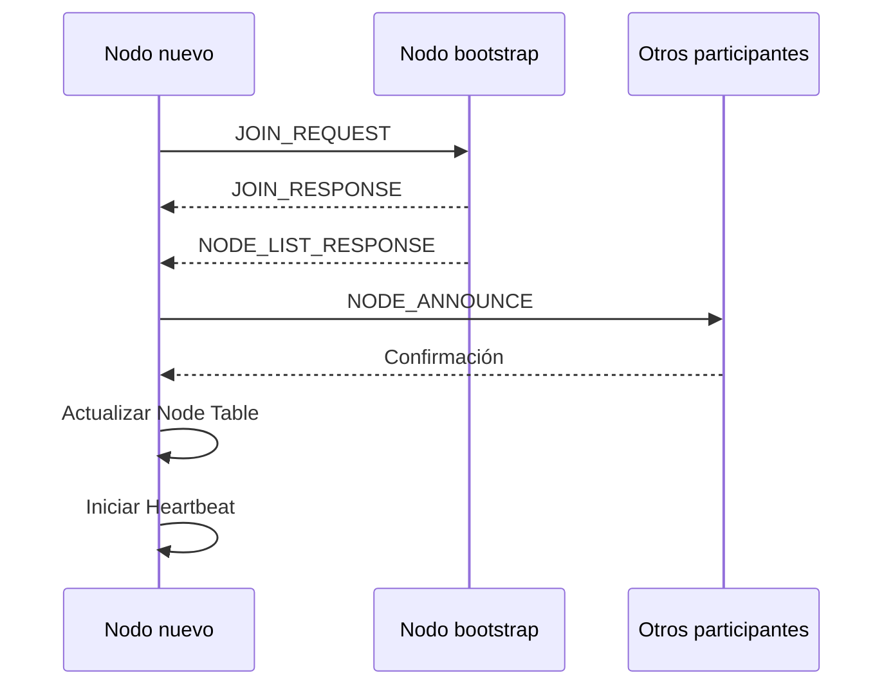
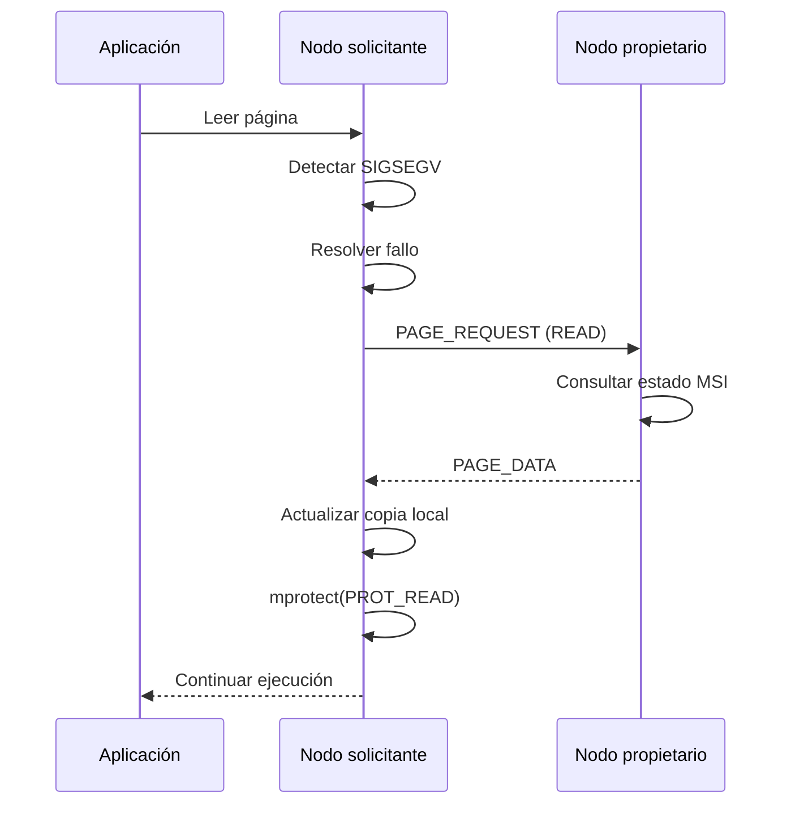
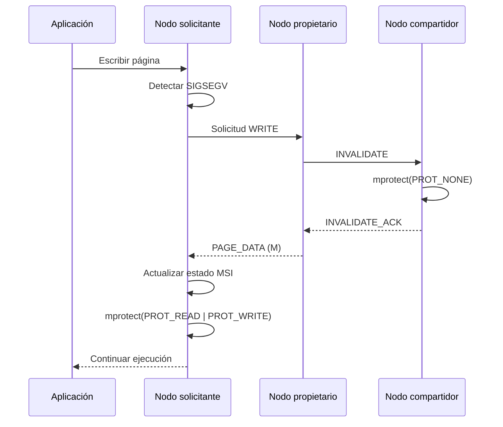

# Instituto Tecnológico de Costa Rica

**Escuela de Ingeniería en Computación, Cartago**

**IC-6600 – Principios de Sistemas Operativos**

**II Semestre 2026**

**Profesor:** M.Sc. Esteban Arias Méndez

**Integrantes:** Daniel Campos, Isaac Gamboa

# Entregable 1 – Documento de Diseño

## Implementación de un Sistema de Memoria Compartida Distribuida (DSM) con Paginación bajo Demanda y Coherencia MSI

**Lenguaje de implementación:** C++
**Sistema operativo:** Linux

---

# 1. Alcance del sistema

La primera versión del sistema estará enfocada en proporcionar las siguientes funcionalidades:

1. Inicio de un nodo DSM mediante un archivo de configuración.
2. Incorporación dinámica de nuevos nodos a un sistema existente.
3. Descubrimiento y registro de nodos participantes.
4. Reserva y administración de memoria local.
5. Administración de un espacio de direcciones DSM lógico.
6. Asignación de páginas a nodos propietarios.
7. Carga de páginas bajo demanda.
8. Sincronización de páginas mediante el protocolo MSI.
9. Comunicación concurrente entre nodos.
10. Consultas de información local y global.
11. Ejecución de aplicaciones de prueba mediante un API de memoria compartida.

La arquitectura inicial no contempla un mecanismo completo de recuperación de datos ante la pérdida permanente de un nodo. La redundancia y tolerancia a fallos se consideran una posible extensión del sistema.

---

# 2. Supuestos y decisiones de diseño

Para establecer una base común de implementación, se definen los siguientes supuestos:

| Característica | Decisión |
|---|---|
| Lenguaje | C++ |
| Plataforma | Linux |
| Arquitectura | Peer-to-peer |
| Cantidad de nodos | Dinámica, sin cantidad fija definida en código |
| Comunicación de datos | TCP |
| Comunicación de heartbeat | UDP |
| Tamaño de página predeterminado | 4096 bytes |
| Tamaño de página | Configurable |
| Reserva de memoria | `mmap` |
| Protección de páginas | `mprotect` |
| Detección de fallos | `sigaction` y `SIGSEGV` |
| Concurrencia | Pthreads |
| Sincronización | Mutexes y semáforos POSIX |
| Coherencia | MSI |
| Configuración | Archivo `.conf` |
| Aplicaciones | Consumirán el API del DSM |

### 2.1 Arquitectura descentralizada

Todos los nodos tendrán las mismas responsabilidades fundamentales. No existirá un nodo maestro ni un servidor central encargado de administrar las páginas.

Cada nodo podrá:

- Incorporarse a un sistema DSM existente.
- Registrar su información y compartir su capacidad de memoria.
- Solicitar páginas almacenadas en otros nodos.
- Proporcionar páginas a otros participantes.
- Administrar las páginas que tenga asignadas.
- Mantener copias locales de páginas compartidas.
- Participar en los mecanismos de coherencia.
- Consultar información global del sistema.

La información de los participantes será replicada entre los nodos mediante mensajes de control.

### 2.2 Incorporación dinámica

La cantidad de nodos no estará definida previamente en el código ni limitada por una lista fija en el archivo de configuración.

Se utilizará un mecanismo de descubrimiento mediante nodos semilla (*bootstrap*).

El primer nodo podrá iniciar un nuevo sistema DSM. Los nodos posteriores podrán conectarse indicando la dirección IP y el puerto de cualquier participante conocido.

Por ejemplo:

```bash
./dsm_node --config dsm.conf --bootstrap 192.168.1.10:5000
```

Cuando un nodo se incorpore:

1. Establecerá una conexión TCP con un nodo existente.
2. Enviará un mensaje `JOIN_REQUEST`.
3. Recibirá la información de los nodos conocidos.
4. Anunciará su incorporación al resto de participantes.
5. Registrará la información de los nodos recibidos.
6. Comenzará a participar en el intercambio de páginas y mensajes de heartbeat.

El nodo utilizado para el descubrimiento inicial no tendrá responsabilidades especiales después de completar el proceso de incorporación.

---

# 3. Arquitectura general del sistema

## 3.1 Descripción general

El sistema estará compuesto por múltiples instancias independientes del programa DSM, cada una ejecutándose en una computadora o terminal diferente.

Cada instancia representará un nodo del sistema y tendrá los módulos necesarios para administrar su memoria, comunicarse con otros participantes y atender las solicitudes de los procesos locales.

La arquitectura estará dividida en cinco componentes principales:

1. Virtual Memory Manager.
2. Network Manager.
3. Pager.
4. Data Structures and Tables.
5. DSM API.

### 3.2 Virtual Memory Manager

Este módulo será responsable de administrar el espacio de memoria virtual reservado por el nodo.

Sus principales responsabilidades serán:

- Reservar el espacio de direcciones mediante `mmap`.
- Establecer los permisos de acceso mediante `mprotect`.
- Administrar las regiones de memoria utilizadas por el DSM.
- Habilitar los permisos correspondientes cuando una página esté disponible localmente.
- Mantener las páginas inválidas protegidas contra accesos no autorizados.

Se utilizará inicialmente una región de memoria virtual reservada con `PROT_NONE`. Conforme las páginas sean solicitadas, el sistema podrá habilitar sus permisos de lectura o escritura.

Es importante distinguir entre la memoria virtual reservada y la memoria física aportada por cada nodo. Reservar un espacio de direcciones mediante `mmap` no significa que toda esa memoria se esté ocupando. La memoria física se utilizará conforme se materialicen las páginas.

### 3.3 Network Manager

El Network Manager administrará toda la comunicación entre los participantes.

Estará compuesto por tres elementos:

**Listener**

Hilo dedicado a escuchar conexiones TCP entrantes. Recibirá solicitudes de otros nodos y distribuirá los mensajes hacia los componentes encargados de procesarlos.

**Workers**

Conjunto de hilos encargados de procesar las solicitudes de red de manera concurrente.

Entre sus responsabilidades se encuentran:

- Procesar solicitudes de páginas.
- Enviar y recibir contenido de páginas.
- Procesar mensajes de invalidación.
- Atender solicitudes de incorporación de nodos.
- Intercambiar información de control.

**Heartbeat**

Componente encargado de verificar periódicamente la disponibilidad de los participantes mediante mensajes UDP.

Cada nodo enviará mensajes periódicos a los demás participantes y actualizará el estado de disponibilidad de su tabla de nodos.

### 3.4 Pager

El Pager será responsable de administrar la paginación bajo demanda y la coherencia de las páginas.

Sus componentes principales serán:

**SIGSEGV Handler**

Detectará accesos a páginas que no tengan permisos suficientes o que no estén disponibles localmente.

**On-demand Paging**

Determinará si una página debe solicitarse a otro nodo, cargarse desde el almacenamiento local o actualizar sus permisos.

**MSI Protocol**

Controlará los estados de las páginas y coordinará las operaciones de lectura, escritura e invalidación.

### 3.5 Data Structures and Tables

Cada nodo mantendrá estructuras de información que permitan conocer el estado local y global del sistema.

Se utilizarán las siguientes tablas:

| Estructura | Responsabilidad |
|---|---|
| Local Page Table | Información de las páginas conocidas y sus estados locales. |
| Node Table | Registro de los nodos participantes. |
| Assignment Table | Relación entre páginas y nodos propietarios. |
| Global Control Table | Información de control sobre la coherencia de las páginas. |
| Statistics | Estadísticas de uso y rendimiento. |

### 3.6 DSM API

El API proporcionará una interfaz de programación para que las aplicaciones puedan reservar, consultar y liberar regiones de memoria DSM.

Las aplicaciones no necesitarán conocer si una página está almacenada localmente o en otro nodo. El sistema se encargará de resolver los accesos mediante los mecanismos de paginación y comunicación.

---

# 4. Diseño de estructuras de datos

Las estructuras de datos deberán permitir identificar páginas, nodos, propietarios, estados de coherencia y asignaciones de memoria.

Para la implementación se utilizarán tipos de tamaño fijo de C++ cuando sea necesario intercambiar información entre nodos.

Algunos tipos de datos a utilizar:

- `uint8_t`: 1 byte.
- `uint16_t`: 2 bytes.
- `uint32_t`: 4 bytes.
- `uint64_t`: 8 bytes.
- `size_t`: tamaño dependiente de la arquitectura.
- `std::string`: cadenas de caracteres.
- `std::vector`: colecciones dinámicas.
- `std::unordered_map`: tablas de búsqueda.

Los tamaños indicados en esta sección corresponden a los campos individuales. El tamaño final de las estructuras en memoria dependerá de la alineación y el padding del compilador.

## 4.1 Identificador de nodo

Cada nodo tendrá un identificador único dentro del sistema DSM.

```cpp
using NodeId = uint64_t;
```

El identificador se generará al iniciar el nodo y se mantendrá durante su participación en el sistema.

La dirección IP y los puertos serán atributos independientes del identificador.

## 4.2 Información de un nodo

```cpp
struct NodeInfo {
    NodeId id;
    std::string ip_address;

    uint16_t tcp_port;
    uint16_t heartbeat_port;

    uint64_t total_memory;
    uint64_t used_memory;

    uint64_t last_heartbeat;

    bool active;
};
```

Descripción:

| Campo | Tipo | Descripción |
|---|---|---|
| id | uint64_t | Identificador único del nodo. |
| ip_address | string | Dirección IP o nombre del equipo. |
| tcp_port | uint16_t | Puerto TCP principal. |
| heartbeat_port | uint16_t | Puerto UDP de heartbeat. |
| total_memory | uint64_t | Memoria aportada al DSM, en bytes. |
| used_memory | uint64_t | Memoria actualmente utilizada, en bytes. |
| last_heartbeat | uint64_t | Último heartbeat recibido. |
| active | bool | Disponibilidad conocida del nodo. |

El campo `last_heartbeat` permitirá determinar si un participante continúa respondiendo.

## 4.3 Estados MSI

Se utilizará un enumerado para representar los estados de coherencia:

```cpp
enum class MSIState : uint8_t {
    MODIFIED = 0,
    SHARED   = 1,
    INVALID  = 2
};
```

Cada estado representa una condición diferente de acceso a la página.

- MODIFIED: el nodo mantiene la copia válida y exclusiva para escritura.
- SHARED: el nodo mantiene una copia válida de solo lectura.
- INVALID: la copia local no es válida o no está disponible.

## 4.4 Información de una página

```cpp
using PageId = uint64_t;

struct PageInfo {
    PageId page_id;

    NodeId owner_id;

    MSIState state;

    uint64_t version;

    bool locally_present;

    std::vector<NodeId> sharers;
};
```

Descripción:

| Campo | Tipo | Descripción |
|---|---|---|
| page_id | uint64_t | Identificador lógico de la página. |
| owner_id | uint64_t | Nodo responsable de la página. |
| state | MSIState | Estado MSI de la copia local. |
| version | uint64_t | Versión del contenido de la página. |
| locally_present | bool | Indica si existe una copia local. |
| sharers | vector | Nodos que mantienen una copia compartida. |

La lista de nodos compartidores será mantenida por el propietario de la página.

La información sobre los compartidores podrá ser consultada mediante mensajes de control.

## 4.5 Tabla local de páginas

Cada nodo mantendrá una tabla de páginas para identificar las páginas que puede administrar o consultar.

```cpp
using LocalPageTable =
    std::unordered_map<PageId, PageInfo>;
```

Esta tabla permitirá realizar búsquedas por identificador de página.

## 4.6 Tabla de nodos

```cpp
using NodeTable =
    std::unordered_map<NodeId, NodeInfo>;
```

Almacena la información de todos los participantes conocidos por el nodo.

Su contenido será actualizado cuando se incorporen nuevos participantes o cuando se detecten cambios en su disponibilidad.

## 4.7 Tabla de asignaciones

```cpp
struct PageAssignment {
    PageId page_id;

    NodeId owner_id;

    uint64_t region_id;

    uint64_t region_offset;
};

using AssignmentTable =
    std::unordered_map<PageId, PageAssignment>;
```

Esta tabla relacionará cada página con el nodo que proporciona su almacenamiento y con la región lógica a la que pertenece.

La asignación de páginas se realizará mediante un mecanismo distribuido que evite asignaciones duplicadas.

## 4.8 Tabla de control global

Se utilizará una tabla de control para almacenar la información necesaria para administrar las páginas y coordinar las operaciones de coherencia.

```cpp
struct GlobalPageControl {
    PageId page_id;

    NodeId owner_id;

    MSIState owner_state;

    uint64_t version;

    std::vector<NodeId> sharers;

    bool write_in_progress;
};
```

Esta información será mantenida por el nodo propietario de cada página y podrá replicarse parcialmente en otros participantes.

No existirá una única tabla global alojada en un servidor central. La información global se obtendrá consultando y combinando los registros de los distintos nodos.

## 4.9 Estadísticas

```cpp
struct NodeStatistics {
    uint64_t pages_owned;
    uint64_t pages_shared;
    uint64_t page_faults;

    uint64_t page_requests;
    uint64_t page_transfers;

    uint64_t bytes_sent;
    uint64_t bytes_received;

    uint64_t invalidations_sent;
    uint64_t invalidations_received;
};
```

Estas estadísticas permitirán evaluar el comportamiento del sistema durante las pruebas.

---

# 5. Gestión de memoria virtual y paginación bajo demanda

## 5.1 Reserva de memoria

Al iniciar, cada nodo reservará una región de memoria virtual mediante `mmap`.

La cantidad de memoria física que aportará al sistema será definida en el archivo de configuración.

Ejemplo:

```cpp
void* memory = mmap(
    nullptr,
    memory_size,
    PROT_NONE,
    MAP_PRIVATE | MAP_ANONYMOUS,
    -1,
    0
);
```

El espacio reservado representará la región virtual utilizada por el DSM.

Cada nodo podrá tener una representación virtual local del espacio DSM, mientras que las páginas físicas estarán distribuidas entre los diferentes participantes.

La asignación de memoria física se realizará bajo demanda, evitando reservar RAM innecesariamente.

## 5.2 Protección de páginas

Inicialmente, las páginas que no estén disponibles localmente tendrán protección `PROT_NONE`.

Cuando una página se encuentre disponible para lectura, se utilizará:

```cpp
mprotect(page_address, page_size, PROT_READ);
```

Cuando el protocolo MSI permita escritura exclusiva:

```cpp
mprotect(
    page_address,
    page_size,
    PROT_READ | PROT_WRITE
);
```

Cuando una página sea invalidada:

```cpp
mprotect(page_address, page_size, PROT_NONE);
```

La modificación de permisos se realizará respetando los límites y la alineación del tamaño de página del sistema operativo.

## 5.3 Detección de fallos SIGSEGV

Se instalará un manejador de señales utilizando `sigaction` y la bandera `SA_SIGINFO`.

Esto permitirá obtener información sobre la dirección virtual que ocasionó el fallo.

Ejemplo conceptual:

```cpp
struct sigaction sa {};

sa.sa_sigaction = segv_handler;
sa.sa_flags = SA_SIGINFO;

sigemptyset(&sa.sa_mask);

sigaction(SIGSEGV, &sa, nullptr);
```

El manejador recibirá:

```cpp
void segv_handler(
    int signal,
    siginfo_t* info,
    void* context
);
```

A partir de `info->si_addr` se determinará la dirección que produjo el fallo.

El identificador de página se calculará utilizando el desplazamiento respecto a la dirección inicial de la región DSM:

```cpp
page_id = (fault_address - region_base) / page_size;
```

## 5.4 Procesamiento de fallos

El manejador de señales no ejecutará directamente operaciones de red, asignaciones dinámicas de memoria ni bloqueos de mutexes.

En su lugar, se utilizará un mecanismo de comunicación seguro entre el manejador y un hilo encargado de resolver los fallos.

El flujo propuesto será:

1. Un hilo de usuario intenta acceder a una página.
2. El kernel genera `SIGSEGV`.
3. El manejador identifica la dirección que produjo el fallo.
4. El manejador registra el evento mediante una operación segura para señales, como `write` sobre un descriptor de una tubería.
5. El hilo encargado de resolver fallos recibe el evento.
6. Se consulta el estado de la página.
7. Si es necesario, se solicita la página al propietario mediante TCP.
8. Se procesa la respuesta y se actualiza el contenido local.
9. Se establecen los permisos adecuados mediante `mprotect`.
10. Se notifica al hilo afectado para que continúe su ejecución.

Para implementar la espera del hilo afectado se utilizará un mecanismo de notificación mediante señales y una espera compatible con las restricciones de seguridad de los manejadores. La implementación deberá evitar que el hilo reintente el acceso antes de que la página esté lista.

## 5.5 Tipos de fallos

Se contemplan dos situaciones principales:

**Fallo de lectura**

Ocurre cuando un proceso intenta leer una página que no está disponible localmente.

El sistema consultará el propietario, solicitará una copia y, cuando sea posible, establecerá el estado SHARED.

**Fallo de escritura**

Ocurre cuando un proceso intenta escribir sobre una página que está protegida como solo lectura o que no está disponible localmente.

El sistema deberá solicitar acceso exclusivo y ejecutar el protocolo de invalidación sobre las demás copias existentes.

---

# 6. Diseño del protocolo de coherencia MSI

## 6.1 Descripción general

El protocolo MSI permitirá mantener la coherencia entre las copias de una misma página almacenadas en diferentes nodos.

Cada copia local tendrá uno de los siguientes estados:

| Estado | Significado | Permisos |
|---|---|---|
| Modified (M) | Copia exclusiva y modificada. | Lectura y escritura |
| Shared (S) | Copia sincronizada compartida. | Solo lectura |
| Invalid (I) | Copia no disponible o desactualizada. | Sin permisos |

El nodo propietario será responsable de coordinar las operaciones de coherencia correspondientes a su página.

## 6.2 Transiciones de estado

Las principales transiciones serán:

| Estado inicial | Evento | Acción | Estado final |
|---|---|---|---|
| I | Lectura | Solicitar página al propietario. | S |
| I | Escritura | Solicitar propiedad exclusiva. | M |
| S | Lectura | Utilizar copia local. | S |
| S | Escritura | Solicitar invalidación de otras copias. | M |
| M | Lectura remota | Compartir contenido y degradar al estado compartido. | S |
| M | Escritura local | Continuar utilizando la copia exclusiva. | M |
| M | Invalidación o transferencia de propiedad | Transferir contenido y actualizar estados. | I |

## 6.3 Lectura de una página

Cuando un nodo necesite leer una página:

1. Comprueba si tiene una copia válida.
2. Si se encuentra en estado S o M, permite la lectura.
3. Si se encuentra en estado I, envía `PAGE_REQUEST` al propietario.
4. El propietario consulta el estado MSI.
5. Si el propietario tiene la página en M, proporciona el contenido actualizado y realiza la transición correspondiente a S.
6. El nodo solicitante recibe `PAGE_DATA`.
7. Se actualiza su copia local y se establece el permiso de lectura.

El propietario registrará al nuevo nodo como compartidor.

## 6.4 Escritura de una página

Cuando un nodo necesite escribir sobre una página:

1. Comprueba el estado local.
2. Si está en M, puede escribir directamente.
3. Si está en S o I, solicita acceso exclusivo.
4. El propietario identifica los nodos que mantienen copias compartidas.
5. Envía mensajes `INVALIDATE` a los participantes correspondientes.
6. Cada nodo invalida su copia local mediante `mprotect(PROT_NONE)`.
7. Los participantes responden con `INVALIDATE_ACK`.
8. El propietario confirma que se puede conceder el acceso exclusivo.
9. El nodo solicitante recibe la página y los permisos correspondientes.
10. El nodo pasa al estado M.

La escritura solamente podrá comenzar cuando se haya completado la invalidación de las copias anteriores.


## 6.5 Control de versiones

Cada página mantendrá un número de versión (`uint64_t`) que aumentará cuando se complete una operación de escritura.

Este valor permitirá detectar respuestas desactualizadas y ayudar a validar que las transferencias correspondan a la versión esperada.

El propietario será responsable de mantener la versión vigente.

---

# 7. Capa de red y protocolo de mensajería

## 7.1 Comunicación TCP

TCP será utilizado para los mensajes de control y transferencia de páginas.

Cada nodo tendrá un puerto TCP de escucha.

El Network Listener Thread recibirá las conexiones entrantes y distribuirá las solicitudes entre los hilos de procesamiento.

Se utilizará un protocolo de mensajes estructurado, con una cabecera de tamaño fijo y un contenido de longitud variable.

## 7.2 Formato general de mensajes

Se propone la siguiente estructura lógica:

```cpp
struct MessageHeader {
    uint32_t magic;
    uint16_t version;
    uint16_t type;

    uint32_t payload_size;

    uint64_t message_id;

    uint64_t sender_id;
    uint64_t receiver_id;

    uint32_t flags;
    uint32_t reserved;
};
```

Tamaño de la cabecera:

| Campo | Tamaño |
|---|---:|
| magic | 4 bytes |
| version | 2 bytes |
| type | 2 bytes |
| payload_size | 4 bytes |
| message_id | 8 bytes |
| sender_id | 8 bytes |
| receiver_id | 8 bytes |
| flags | 4 bytes |
| reserved | 4 bytes |
| **Total** | **44 bytes** |

La cabecera tendrá un tamaño lógico de 44 bytes. Se utilizará serialización explícita para evitar diferencias de alineación, padding y representación entre compiladores y arquitecturas.

Todos los campos numéricos del protocolo utilizarán orden de bytes de red (*network byte order*).

El campo `magic` permitirá identificar mensajes pertenecientes al protocolo DSM.

El campo `version` permitirá identificar la versión del protocolo.

El campo `type` indicará el tipo de mensaje.

El campo `payload_size` indicará la longitud del contenido adicional.

El campo `message_id` permitirá identificar cada solicitud y relacionar respuestas con sus solicitudes originales.

## 7.3 Tipos de mensajes

Se definen los siguientes tipos iniciales:

| Código | Mensaje | Transporte | Descripción |
|---:|---|---|---|
| 1 | JOIN_REQUEST | TCP | Solicita incorporación al sistema. |
| 2 | JOIN_RESPONSE | TCP | Responde a una solicitud de incorporación. |
| 3 | NODE_ANNOUNCE | TCP | Anuncia un nuevo nodo. |
| 4 | NODE_LIST_REQUEST | TCP | Solicita la lista de participantes conocidos. |
| 5 | NODE_LIST_RESPONSE | TCP | Devuelve información de nodos conocidos. |
| 6 | PAGE_REQUEST | TCP | Solicita una página de memoria. |
| 7 | PAGE_DATA | TCP | Transfiere el contenido de una página. |
| 8 | INVALIDATE | TCP | Solicita invalidar una copia. |
| 9 | INVALIDATE_ACK | TCP | Confirma una invalidación. |
| 10 | PAGE_RELEASE | TCP | Notifica liberación o cambio de asignación. |
| 11 | STATUS_REQUEST | TCP | Solicita información del estado del nodo. |
| 12 | STATUS_RESPONSE | TCP | Devuelve información estadística. |
| 13 | ERROR_RESPONSE | TCP | Informa sobre un error. |
| 14 | HEARTBEAT | UDP | Informa que un nodo continúa activo. |

Los mensajes podrán ampliarse durante el desarrollo del prototipo.

## 7.4 Mensaje JOIN_REQUEST

Se utilizará cuando un nodo nuevo desee incorporarse al sistema.

Contenido propuesto:

```cpp
struct JoinRequest {
    NodeId node_id;

    uint64_t memory_size;

    uint16_t tcp_port;
    uint16_t heartbeat_port;

    uint16_t protocol_version;
};
```

El nodo existente validará la solicitud y responderá con `JOIN_RESPONSE`.

## 7.5 Mensaje PAGE_REQUEST

Se utilizará para solicitar el contenido o los permisos de una página.

```cpp
struct PageRequest {
    PageId page_id;

    uint64_t region_id;

    uint8_t access_type;
    uint8_t current_state;

    uint64_t known_version;
};
```

El campo `access_type` permitirá distinguir entre solicitudes de lectura y escritura.

Valores:

- 0: READ.
- 1: WRITE.

## 7.6 Mensaje PAGE_DATA

Permitirá transferir el contenido de una página y la información necesaria para actualizar su estado local.

```cpp
struct PageData {
    PageId page_id;

    uint64_t version;

    uint8_t state;

    uint32_t data_size;

    // Contenido de la página enviado como payload.
};
```

El contenido de la página se transmitirá como un bloque adicional al mensaje.

Para una página de 4096 bytes, el payload de datos tendrá exactamente 4096 bytes.

## 7.7 Mensaje INVALIDATE

Se utilizará para notificar a un nodo que su copia local de una página debe invalidarse.

```cpp
struct InvalidateMessage {
    PageId page_id;

    uint64_t new_version;

    NodeId new_owner;
};
```

El receptor deberá:

1. Identificar la página.
2. Invalidar su copia local.
3. Aplicar `mprotect(PROT_NONE)`.
4. Actualizar su tabla local.
5. Enviar `INVALIDATE_ACK`.

## 7.8 Mensaje HEARTBEAT

Se utilizará para informar periódicamente que un nodo continúa disponible.

Se propone un paquete UDP compacto:

```cpp
struct HeartbeatMessage {
    uint64_t node_id;

    uint64_t timestamp;

    uint32_t sequence_number;
};
```

Tamaño lógico: 20 bytes.

El campo `sequence_number` permitirá identificar mensajes repetidos o desordenados.

## 7.9 Manejo de errores

El protocolo deberá contemplar los siguientes errores:

| Código | Error | Descripción |
|---:|---|---|
| 1 | INVALID_MESSAGE | Mensaje inválido. |
| 2 | UNKNOWN_NODE | Nodo desconocido. |
| 3 | PAGE_NOT_FOUND | Página inexistente. |
| 4 | ACCESS_DENIED | Operación no permitida. |
| 5 | INVALID_STATE | Estado MSI inesperado. |
| 6 | OUT_OF_MEMORY | Memoria disponible insuficiente. |
| 7 | NODE_UNAVAILABLE | Nodo no disponible. |
| 8 | VERSION_MISMATCH | Versión de página incorrecta. |
| 9 | TIMEOUT | Tiempo de espera agotado. |
| 10 | PROTOCOL_MISMATCH | Versiones de protocolo incompatibles. |

---

# 8. Modelo de concurrencia y sincronización

## 8.1 Modelo de hilos

Cada nodo ejecutará múltiples hilos con responsabilidades independientes.

Se propone la siguiente distribución:

| Hilo | Responsabilidad |
|---|---|
| Main Thread | Inicialización y administración del nodo. |
| TCP Listener | Aceptar conexiones entrantes. |
| Network Workers | Procesar mensajes de otros nodos. |
| Heartbeat Thread | Enviar y recibir mensajes de disponibilidad. |
| Fault Handler Worker | Resolver los fallos de página detectados. |
| Statistics Thread | Actualizar y recopilar estadísticas. |
| Application Threads | Ejecutar las aplicaciones que utilizan el DSM. |

La cantidad de hilos de procesamiento de red podrá configurarse.

## 8.2 Sincronización

Debido a que varios hilos podrán consultar y modificar simultáneamente las tablas de control, se utilizarán mecanismos de sincronización.

Se implementarán:

- Mutexes POSIX mediante `pthread_mutex_t`.
- Semáforos POSIX mediante `sem_t`.
- Variables de condición cuando sean necesarias.
- Operaciones atómicas para contadores y estados que lo permitan.

Se propone proteger las estructuras de la siguiente manera:

| Estructura | Mecanismo |
|---|---|
| Local Page Table | Mutex de tabla o mutex por página. |
| Node Table | Mutex de nodos. |
| Assignment Table | Mutex de asignaciones. |
| Global Control Table | Mutex por página. |
| Statistics | Operaciones atómicas o mutex. |
| Cola de fallos | Pipe y semáforos POSIX. |

Se evitará utilizar un único mutex global para todas las operaciones, debido a que podría limitar la concurrencia y generar tiempos de espera innecesarios.

## 8.3 Prevención de interbloqueos

Se establecerán las siguientes reglas:

1. Los mutexes deberán adquirirse siguiendo un orden consistente.
2. No se mantendrán bloqueos de tablas mientras se espera una respuesta de red.
3. Las solicitudes de red tendrán tiempos máximos de espera.
4. Las operaciones de invalidación utilizarán identificadores de solicitud.
5. Los hilos no deberán esperar indefinidamente por respuestas de otros nodos.
6. Los mensajes duplicados deberán poder identificarse mediante `message_id`.
7. Las operaciones sobre una misma página deberán serializarse cuando sea necesario.

Se prestará especial atención a las operaciones MSI que involucren varios nodos, ya que podrían producir esperas circulares si no se establecen reglas claras de adquisición de bloqueos.

## 8.4 Comunicación entre SIGSEGV y los hilos de procesamiento

El manejador de señales tendrá restricciones especiales.

No realizará operaciones de red, asignaciones dinámicas, operaciones de entrada/salida complejas ni bloqueos tradicionales.

Se utilizará una tubería de comunicación entre el manejador y el Fault Handler Worker.

La escritura de eventos mediante `write` permite utilizar una operación compatible con manejadores de señales.

El procesamiento de las solicitudes, incluyendo sockets, semáforos y mutexes, se realizará desde el hilo de trabajo.

---

# 9. Diseño inicial del API DSM

## 9.1 Objetivo

El API permitirá que las aplicaciones utilicen el espacio de memoria compartida sin necesitar conocer los mecanismos internos de distribución, comunicación y coherencia.

Se propone desarrollar una interfaz en C++ basada en una clase principal `DSM` y una abstracción `DSMRegion`.

Las aplicaciones utilizarán esta interfaz para inicializar el sistema, crear regiones de memoria, acceder a sus datos y liberar los recursos.

## 9.2 Tipos principales

```cpp
using DSMRegionId = uint64_t;

enum class DSMAccess {
    READ,
    WRITE,
    READ_WRITE
};

enum class DSMError {
    SUCCESS,
    INITIALIZATION_ERROR,
    OUT_OF_MEMORY,
    INVALID_REGION,
    INVALID_ACCESS,
    NETWORK_ERROR,
    NODE_UNAVAILABLE,
    PAGE_FAULT_ERROR,
    INTERNAL_ERROR
};
```

## 9.3 Clase DSM

Interfaz inicial propuesta:

```cpp
class DSM {
public:

    static DSMError initialize(
        const std::string& config_path
    );

    static DSMRegion create_region(
        size_t size,
        DSMAccess access
    );

    static DSMError release_region(
        DSMRegionId region_id
    );

    static DSMError shutdown();

    static DSMStatistics get_statistics();

    static DSMNodeInfo get_local_node();

    static std::vector<DSMNodeInfo> get_nodes();
};
```

## 9.4 Clase DSMRegion

Representará una región de memoria compartida.

```cpp
class DSMRegion {
public:

    DSMRegionId get_id() const;

    size_t get_size() const;

    void* data();

    const void* data() const;

    template<typename T>
    T* as();

    template<typename T>
    const T* as() const;

    bool valid() const;
};
```

La función `data()` devolverá la dirección virtual local de la región DSM.

Los accesos realizados sobre esta dirección serán controlados por los mecanismos de protección de memoria y paginación bajo demanda.

## 9.5 Descripción de funciones

| Función | Descripción | Entrada | Salida |
|---|---|---|---|
| initialize | Inicializa el nodo DSM y sus componentes. | Ruta del archivo `.conf`. | Estado de inicialización. |
| create_region | Solicita una nueva región de memoria compartida. | Tamaño y permisos. | Objeto DSMRegion. |
| release_region | Libera una región previamente creada. | Identificador de región. | Código de resultado. |
| shutdown | Finaliza ordenadamente el nodo DSM. | Ninguna. | Código de resultado. |
| get_statistics | Obtiene estadísticas locales. | Ninguna. | Estructura de estadísticas. |
| get_local_node | Obtiene información del nodo local. | Ninguna. | Información del nodo. |
| get_nodes | Obtiene la lista de nodos conocidos. | Ninguna. | Vector de nodos. |
| get_id | Obtiene el identificador de una región. | Ninguna. | Identificador. |
| get_size | Obtiene el tamaño de una región. | Ninguna. | Tamaño en bytes. |
| data | Obtiene la dirección virtual de la región. | Ninguna. | Puntero a memoria. |
| as<T> | Obtiene un puntero tipado. | Tipo de dato. | Puntero tipado. |
| valid | Comprueba si la región es válida. | Ninguna. | Valor booleano. |

## 9.6 Ejemplo de utilización

El siguiente ejemplo muestra el uso esperado del API desde una aplicación independiente:

```cpp
#include "dsm.hpp"
#include <iostream>

int main() {

    DSMError result =
        DSM::initialize("dsm.conf");

    if (result != DSMError::SUCCESS) {
        std::cerr << "Error initializing DSM\n";
        return 1;
    }

    auto region = DSM::create_region(
        4096 * 100,
        DSMAccess::READ_WRITE
    );

    if (!region.valid()) {
        std::cerr << "Error creating region\n";
        DSM::shutdown();
        return 1;
    }

    int* values = region.as<int>();

    for (int i = 0; i < 1000; i++) {
        values[i] = i;
    }

    std::cout << "First value: "
              << values[0] << '\n';

    DSM::release_region(region.get_id());

    DSM::shutdown();

    return 0;
}
```

Este ejemplo representa la interfaz deseada. La implementación interna será responsable de resolver los fallos de página y sincronizar los accesos entre nodos.

### 9.7 Consideraciones del API

El acceso mediante punteros permitirá mantener una interfaz similar a la programación tradicional con memoria.

Sin embargo, se deberán establecer las siguientes restricciones:

- Las regiones tendrán un tamaño definido al momento de crearse.
- Los accesos deberán realizarse dentro de los límites de la región.
- Los permisos deberán respetarse.
- Los punteros serán válidos únicamente dentro del proceso que creó la representación virtual local.
- No se deberán transmitir punteros entre nodos. Se transmitirán identificadores de región, desplazamientos y datos.
- Las operaciones de sincronización entre hilos de aplicación deberán utilizar los mecanismos definidos por el DSM.

El API podrá ampliarse durante los siguientes prototipos según las necesidades de las aplicaciones de validación.

---

# 10. Archivo de configuración

## 10.1 Descripción

El sistema utilizará un archivo de configuración general denominado `dsm.conf`.

Este archivo permitirá establecer los parámetros necesarios para ejecutar los nodos sin modificar el código fuente.

La configuración no contendrá una cantidad fija de nodos ni requerirá conocer previamente todos los participantes.

Se utilizarán parámetros para definir los puertos, el tamaño de página, la cantidad de memoria aportada y los intervalos de comunicación.

## 10.2 Configuración propuesta

```ini
[general]
node_name=node1
memory_size=104857600
page_size=4096

[network]
bind_address=0.0.0.0
tcp_port=5000
heartbeat_port=5001
control_port=5002

[discovery]
bootstrap_nodes=

[heartbeat]
interval_ms=1000
timeout_ms=5000

[network_workers]
worker_count=4
max_connections=64

[paging]
max_pending_faults=1024
request_timeout_ms=5000

[logging]
log_level=INFO
log_file=dsm.log
```

## 10.3 Descripción de parámetros

| Parámetro | Tipo | Valor inicial | Descripción |
|---|---|---|---|
| node_name | string | node1 | Nombre descriptivo del nodo. |
| memory_size | uint64_t | 104857600 | Memoria física que aporta el nodo, en bytes. |
| page_size | uint32_t | 4096 | Tamaño de página en bytes. |
| bind_address | string | 0.0.0.0 | Dirección donde se escucharán conexiones. |
| tcp_port | uint16_t | 5000 | Puerto principal TCP. |
| heartbeat_port | uint16_t | 5001 | Puerto UDP de heartbeat. |
| control_port | uint16_t | 5002 | Puerto reservado para control, si se utiliza un canal separado. |
| bootstrap_nodes | list | Vacío | Nodos iniciales conocidos. |
| interval_ms | uint32_t | 1000 | Intervalo entre heartbeats. |
| timeout_ms | uint32_t | 5000 | Tiempo para considerar sospechoso un nodo. |
| worker_count | uint32_t | 4 | Cantidad de hilos de procesamiento de red. |
| max_connections | uint32_t | 64 | Máximo de conexiones TCP concurrentes. |
| max_pending_faults | uint32_t | 1024 | Capacidad de eventos pendientes de resolución. |
| request_timeout_ms | uint32_t | 5000 | Tiempo máximo de espera de solicitudes. |
| log_level | string | INFO | Nivel de registro. |
| log_file | string | dsm.log | Archivo de registro. |

Los valores presentados son iniciales y podrán ajustarse según los resultados de las pruebas.

## 10.4 Inicio de nodos

El primer nodo podrá iniciar el sistema sin especificar un nodo semilla:

```bash
./dsm_node --config dsm.conf
```

Los siguientes nodos podrán incorporarse indicando un participante existente:

```bash
./dsm_node --config dsm.conf \
    --bootstrap 192.168.1.10:5000
```

Cada nodo podrá utilizar un archivo de configuración diferente, siempre que los parámetros generales del protocolo sean compatibles.

El tamaño de página y la versión del protocolo deberán coincidir entre los participantes de un mismo sistema DSM.

---

# 11. Administración y consulta de información

Cada nodo deberá permitir consultar información local y global.

Las consultas locales utilizarán las tablas mantenidas por el propio participante.

Las consultas globales se realizarán mediante solicitudes a los nodos conocidos y la combinación de las respuestas obtenidas.

Se proponen los siguientes comandos administrativos:

| Comando | Descripción |
|---|---|
| `nodes` | Muestra los nodos conocidos. |
| `nodes --active` | Muestra los nodos considerados disponibles. |
| `memory` | Muestra el uso de memoria local. |
| `memory --global` | Muestra el uso de memoria del sistema. |
| `pages` | Muestra la tabla local de páginas. |
| `pages --global` | Consulta información de páginas de todos los nodos. |
| `stats` | Muestra estadísticas del nodo local. |
| `stats --global` | Muestra estadísticas globales. |

La salida deberá mostrar, como mínimo:

- Identificador y dirección IP del nodo.
- Memoria total aportada.
- Memoria utilizada y disponible.
- Cantidad de páginas asignadas.
- Cantidad de páginas compartidas.
- Cantidad de páginas modificadas.
- Cantidad de fallos de página.
- Transferencias de memoria.
- Invalidaciones realizadas y recibidas.

La información global podrá ser incompleta si algún nodo no responde. En ese caso, se deberá indicar qué participantes no pudieron ser consultados.

---

# 12. Manejo de errores y disponibilidad

## 12.1 Detección de nodos no disponibles

El mecanismo de heartbeat permitirá detectar participantes que dejan de responder.

Cada nodo enviará mensajes periódicos a los participantes conocidos.

Si transcurre el tiempo configurado sin recibir mensajes, el nodo será marcado inicialmente como sospechoso.

Después de realizar verificaciones adicionales podrá considerarse no disponible.

Es importante distinguir entre un nodo caído y una interrupción temporal de red.

## 12.2 Pérdida de conexión

Cuando se pierda una conexión TCP:

1. Se registrará el error.
2. Se actualizará la información de disponibilidad del participante.
3. Se cancelarán o marcarán como fallidas las solicitudes pendientes relacionadas con ese nodo.
4. Se evitará utilizar información de disponibilidad desactualizada.
5. Se notificará al usuario cuando una operación no pueda completarse.

## 12.3 Limitaciones iniciales

La arquitectura inicial no garantiza la recuperación de una página modificada si su único propietario desaparece antes de transferir o replicar su contenido.

Por lo tanto, la disponibilidad de los nodos y la integridad de los datos son problemas relacionados, pero diferentes.

La detección de fallos será parte del diseño inicial. La redundancia de datos y la recuperación ante pérdida de nodos podrán implementarse como una extensión.

---

# 13. Diagramas de secuencia

## 13.1 Incorporación de un nodo



## 13.2 Lectura de una página



## 13.3 Escritura de una página compartida



---

# 14. Organización inicial del código fuente

Se propone organizar el proyecto en los siguientes módulos:

```text
DSM/
│
├── CMakeLists.txt
│
├── config/
│   └── dsm.conf
│
├── include/
│   ├── dsm.hpp
│   ├── dsm_region.hpp
│   ├── node.hpp
│   ├── page.hpp
│   ├── protocol.hpp
│   ├── network.hpp
│   ├── pager.hpp
│   ├── memory_manager.hpp
│   └── statistics.hpp
│
├── src/
│   ├── main.cpp
│   ├── dsm.cpp
│   ├── dsm_region.cpp
│   ├── node.cpp
│   ├── network.cpp
│   ├── protocol.cpp
│   ├── pager.cpp
│   ├── memory_manager.cpp
│   ├── page_table.cpp
│   ├── heartbeat.cpp
│   ├── signal_handler.cpp
│   ├── synchronization.cpp
│   └── statistics.cpp
│
├── tests/
│   ├── test_network.cpp
│   ├── test_memory.cpp
│   ├── test_msi.cpp
│   └── test_paging.cpp
│
├── apps/
│   └── examples/
│
├── docs/
│
└── README.md
```

### 14.1 Responsabilidades de los módulos

| Archivo | Responsabilidad |
|---|---|
| main.cpp | Punto de entrada e inicialización del nodo. |
| dsm.cpp | Implementación del API principal. |
| dsm_region.cpp | Administración de regiones DSM. |
| node.cpp | Información y administración de nodos. |
| network.cpp | Sockets TCP y comunicación. |
| protocol.cpp | Serialización y procesamiento de mensajes. |
| pager.cpp | Paginación bajo demanda y MSI. |
| memory_manager.cpp | Reserva y protección de memoria. |
| page_table.cpp | Administración de tablas de páginas. |
| heartbeat.cpp | Disponibilidad de nodos mediante UDP. |
| signal_handler.cpp | Registro y manejo de SIGSEGV. |
| synchronization.cpp | Mutexes, semáforos y mecanismos de sincronización. |
| statistics.cpp | Recolección de estadísticas. |

---

# 15. Consideraciones de implementación

Para mantener una arquitectura modular y facilitar las pruebas, se establecen las siguientes consideraciones:

1. El sistema deberá compilarse en Linux utilizando un compilador compatible con C++17 o superior.
2. La comunicación deberá realizarse mediante sockets BSD utilizando TCP y UDP.
3. Los hilos se implementarán mediante Pthreads.
4. Se utilizarán semáforos POSIX para coordinar los eventos entre componentes.
5. Las regiones virtuales se reservarán utilizando `mmap`.
6. Los permisos de memoria se controlarán mediante `mprotect`.
7. La detección de fallos de acceso se realizará mediante `sigaction`.
8. Las estructuras de datos deberán protegerse ante accesos concurrentes.
9. Los mensajes de red deberán utilizar serialización explícita.
10. Las transferencias de páginas deberán verificar su tamaño y versión.
11. Las operaciones de coherencia deberán evitar condiciones de carrera.
12. Se utilizarán identificadores lógicos para representar regiones y páginas, evitando transmitir direcciones virtuales entre nodos.

## 15.1 Consideración sobre la memoria compartida

El espacio de memoria DSM será una abstracción lógica.

Cada proceso tendrá su propia representación virtual local, por lo que no se asumirán direcciones virtuales idénticas entre diferentes computadoras.

Las operaciones de comunicación utilizarán identificadores de región y desplazamientos relativos.

Por ejemplo, en lugar de enviar la dirección virtual de una variable, se transmitirá:

- Identificador de región.
- Identificador de página.
- Desplazamiento dentro de la página.
- Contenido correspondiente.

Esto permitirá que cada nodo utilice una dirección virtual diferente para representar la misma ubicación lógica del sistema.

## 15.2 Consideración sobre las operaciones de escritura

El protocolo MSI garantizará coherencia de páginas, pero no implica por sí mismo que varias operaciones de escritura concurrentes sobre diferentes posiciones de una misma página puedan ejecutarse sin coordinación.

Las aplicaciones deberán utilizar los mecanismos de sincronización disponibles para evitar condiciones de carrera entre sus hilos.

# 16. Plan de implementación

El desarrollo se realizará progresivamente mediante los prototipos establecidos para el proyecto.

## 16.1 Prototipo 1

Se espera desarrollar:

- Inicialización de nodos.
- Lectura del archivo de configuración.
- Comunicación TCP entre dos o más nodos.
- Incorporación dinámica de participantes.
- Envío y recepción de mensajes.
- Reserva de memoria mediante `mmap`.

## 16.2 Prototipo 2

Se espera incorporar:

- Manejo de fallos `SIGSEGV`.
- Resolución de fallos de página.
- Transferencia de páginas.
- Transiciones MSI.
- Invalidación de copias.
- Sincronización entre hilos.

## 16.3 Entrega final

Se espera contar con:

- API funcional.
- Integración de todos los módulos.
- Consultas de información local y global.
- Estadísticas.
- Aplicaciones de validación.
- Pruebas con múltiples computadoras físicas.
- Documentación técnica completa.
